# The complete Clickue guide

← [README](../README.md) · [Feature list](../FEATURES.md) · [Quick start](USER_GUIDE.md) · [Security](../SECURITY.md)

> [!IMPORTANT]
> **Clickue is vibe-coded and was developed with substantial AI assistance.** Caution was taken
> during development, but AI-assisted development does not guarantee bug-free or secure
> software. Review the source and use normal precautions. Test automations safely, protect
> notification credentials, and avoid unattended use for consequential actions.
> More in [section 24](#24-security-privacy-and-responsible-use).

This guide explains **every feature** of Clickue, with real-world scenarios and example
pictures. Read it from top to bottom to learn everything, or jump to the part you need.
In the app, open it from **☰ Menu → Complete guide (online)**. It describes Clickue 4.5.5.

> [!NOTE]
> The example pictures show an invented "Example App" so the ideas are easy to see. Your own
> apps will look different; the steps are the same.

## Contents

**Getting started**
1. [What Clickue does](#1-what-clickue-does)
2. [Installing and the first start](#2-installing-and-the-first-start)
3. [The main window](#3-the-main-window)

**Making jobs**

4. [Choosing where to click](#4-choosing-where-to-click)
5. [Scheduled clicks](#5-scheduled-clicks)
6. [Screen watchers](#6-screen-watchers): exact or partial matching, search areas
7. [When a job may run: active hours and limits](#7-when-a-job-may-run-active-hours-and-limits)
8. [Steps and workflows](#8-steps-and-workflows): step types, Type or Paste, variables, If, Repeat, step groups
9. [Recording a macro](#9-recording-a-macro)

**Running jobs**

10. [Testing a job](#10-testing-a-job): Tests, Dry run, Step through
11. [Starting, pausing, stopping and taking turns](#11-starting-pausing-stopping-and-taking-turns)
12. [Safety features](#12-safety-features)
13. [Notifications and phone alerts](#13-notifications-and-phone-alerts)

**Looking after your jobs**

14. [Managing jobs](#14-managing-jobs): tick boxes, batch actions, Edit together
15. [History, run history, stats and logs](#15-history-run-history-stats-and-logs)
16. [Screen video of runs](#16-screen-video-of-runs)
17. [Backups and your data](#17-backups-and-your-data)
18. [Locked screens, remote desktop and virtual machines](#18-locked-screens-remote-desktop-and-virtual-machines)
19. [Window, tray, hotkeys and appearance](#19-window-tray-hotkeys-and-appearance)
20. [Preferences, setting by setting](#20-preferences-setting-by-setting)

**Reference**

21. [Recipes: complete examples](#21-recipes-complete-examples)
22. [Industries and workflows](#22-industries-and-workflows)
23. [Keyboard shortcuts](#23-keyboard-shortcuts)
24. [Security, privacy and responsible use](#24-security-privacy-and-responsible-use)
25. [Install, portable and uninstall](#25-install-portable-and-uninstall)
26. [Troubleshooting](#26-troubleshooting)
27. [FAQ](#27-faq)
28. [Getting help and suggesting ideas](#28-getting-help-and-suggesting-ideas)

---

## 1. What Clickue does

Clickue clicks on your screen for you, either **on a schedule** or **when something on the
screen changes**, and it can replay routines you **record**. Every automation is called a
**job**, and there are two kinds:

| Kind | Clicks when… | Example |
|---|---|---|
| **Scheduled click** (＋ New click) | a time comes round: every 8 hours, every 5 minutes, at 08:00… | Press *Refresh* every 30 minutes, at a slightly different time each round |
| **Screen watcher** (👁 New watcher) | a picture on the screen **disappears** or **appears** | When the *Connected* badge disappears, click *Reconnect* |

A few ideas run through the whole app:

- **Spots are found by their picture.** When you pick a spot, Clickue saves a small picture
  of it and searches the screen for it before every click. So the click still lands on the
  right button after a window moves, the screen resolution changes, or you connect from a
  different screen. ([Section 4](#4-choosing-where-to-click))
- **Any job can do more after its click (or instead of it):** click other spots, wait, type or
  paste text, press keys, wait for the next picture, branch with **If**, repeat with **Repeat**,
  use **variables** and reusable **step groups**. ([Section 8](#8-steps-and-workflows))
- **Record a macro** once and edit it into reliable steps. ([Section 9](#9-recording-a-macro))
- **It's careful.** It waits while you're using the mouse, won't click when something covers
  the target, never clicks blindly on a locked screen, runs one job at a time, and has an
  emergency stop. ([Section 12](#12-safety-features))
- **Everything can be tested** without waiting for the real time, and without clicking at
  all if you prefer: **Dry run** and **Step through**. ([Section 10](#10-testing-a-job))

Clickue runs on **Windows 10 and 11**. It needs a real, unlocked desktop session to click;
see [section 18](#18-locked-screens-remote-desktop-and-virtual-machines).

---

## 2. Installing and the first start

### Choosing a download

From the [Releases page](https://github.com/jnssylvest/clickue/releases/latest):

| Download | Best for | Notes |
|---|---|---|
| `Clickue-Setup-<version>.exe` | Most people | Installs with Start-menu entries and an uninstaller. Choose **only for me** (no admin needed) or **all users** (Program Files, needs admin). Each Windows user keeps their own jobs |
| `Clickue-Portable-<version>.zip` | USB sticks, locked-down PCs, trying it out | Unzip anywhere and run `Clickue.exe`. All data stays in a `ClickueData` folder beside it |
| `SHA256SUMS.txt` | Checking a download | Compare with `Get-FileHash <file>` in PowerShell |
| Source code | Developers | Python 3 with `pillow`, `pystray`, `opencv-python-headless`, `numpy`. See the [README](../README.md#run-from-source) |

> [!WARNING]
> Clickue isn't code-signed, so Windows SmartScreen may say *"Windows protected your PC"*.
> Click **More info → Run anyway** only if you downloaded it from the official Releases page.
> The installer first shows a short notice about Clickue (including that it's AI-assisted);
> details on installing, the portable version and uninstalling are in
> [section 25](#25-install-portable-and-uninstall).

### What happens on the first start

- **Previous version found.** If jobs from the older *Scheduled AutoClicker* are found,
  Clickue **asks** whether to import them. It never imports silently.
- **Reinstalled?** If you installed again and jobs from before are still in your user folder,
  Clickue asks whether to **keep them** or **start fresh**. Starting fresh saves a backup first
  (shown as *Before a fresh start* in Backups), so nothing is lost.
- **Upgrading.** Your jobs keep working. Every time a new version starts for the first time
  with your jobs, Clickue first saves a backup named *before-upgrade-&lt;version&gt;* (for
  example *before-upgrade-4.5.5*), so you can always go back to the jobs as they were.
- **Jobs file missing or damaged?** If `jobs.json` is gone or can't be read but backups exist,
  Clickue tells you and offers to **restore the newest backup** (it shows its date and the job
  names). Restored jobs start **stopped**, so nothing clicks until you start them.
- **Very old settings file.** A settings file from the very first versions
  (`autoclicker_config.json` next to the program) is only offered for import when the data
  folder has never been used, and only after asking. It is never imported over existing data.
- **Which jobs were loaded.** The Activity log's first lines say how many jobs were loaded,
  from which file, which version saved them and when, and their names.
- **One copy only.** If Clickue is already running (maybe hidden in the tray), starting it
  again just tells you so, instead of opening a second copy that could double-click. Look for
  its icon near the clock (you may need to click the **^** arrow).

---

## 3. The main window

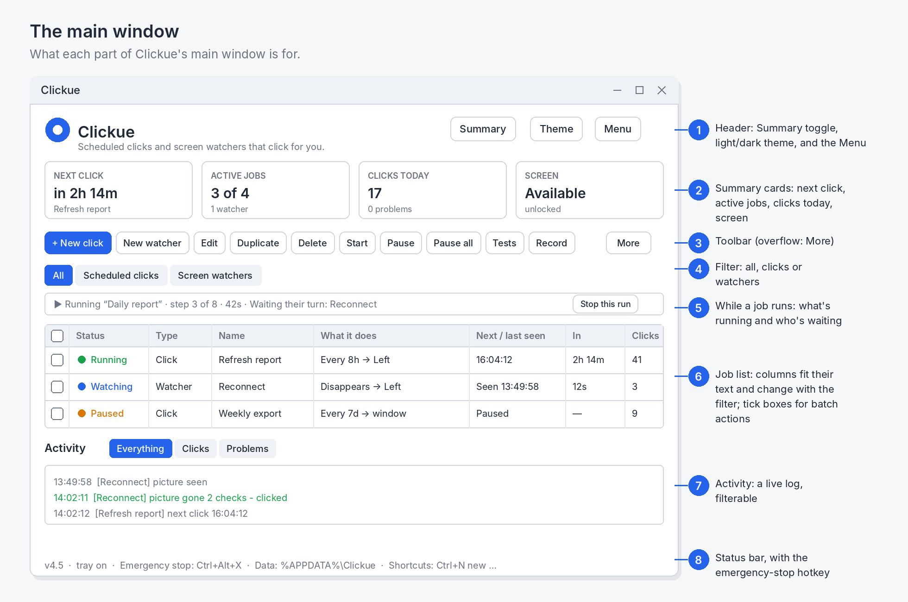

1. **Header.** **▴ Summary** shows or hides the summary cards, the theme button switches
   light/dark, and **☰ Menu** holds everything else (see below).
2. **Summary cards.** The next click and its countdown, how many jobs are active, clicks
   today, and whether the screen is available (not locked or disconnected).
3. **Toolbar.** ＋ New click (blue) and 👁 New watcher (teal) are the two main buttons, then Edit, Duplicate, Delete, ▶ Start / Stop,
   ⏸ Pause (this job), ⏸ Pause all, 🧪 Tests, ⏺ Record, ↓ Import and ↑ Export. When the window
   is too narrow, the least-used buttons fold into **More ▾**.
4. **Filter.** Show all jobs, only scheduled clicks, or only screen watchers.
5. **Job list.** One row per job. **Double-click** a row (or Enter) to edit, **right-click** for
   every action. **Click the empty part** of the list below the rows to unselect; a
   double-click there does nothing. The **tick box** at the start of each row selects jobs for batch actions
   ([section 14](#ticking-jobs-batch-actions)). Less important columns hide when the window
   gets narrow. Column widths can be changed (below).
6. **Activity.** A live, colour-coded log. Filter it to **Clicks** or **Problems**, or type in
   the **🔍 filter** box. Places like *(878, 243)* are links: click one to see that place on
   screen. Right-click for copy and more ([section 15](#logs-copy-filter-and-show-on-screen)).
   It keeps lines from earlier runs; **Clear view** empties it (the log file keeps
   everything); **Open log file** opens the full log.
7. **Status bar.** A one-line summary.

While a job is running, or jobs are waiting their turn, a **bar above the job list** shows
which, with **■ Stop this run** ([section 11](#11-starting-pausing-stopping-and-taking-turns)).
The status bar shows the **emergency stop** hotkey.

**Making the job list or Activity taller.** Drag the divider between them (the dotted bar
above *Activity*; it lights up when the mouse is on it), or use the **▲** / **▼** buttons at
the right of the *Activity* heading (**Ctrl+Up** / **Ctrl+Down**). ▲ gives Activity more room,
▼ gives the job list more room; either can be shrunk almost completely. Clickue remembers the
split.

### The job list columns

The filter above the list (**All**, **Scheduled clicks**, **Screen watchers**) also switches
**which columns** are shown, so each kind of job shows what matters for it.

**Scheduled clicks**

| Column | Shows |
|---|---|
| **☐ / ☑** | The tick box for batch actions (ticked rows are also tinted) |
| **Status** | What the job is doing (see below) |
| **Name** | The job's name |
| **Clicks at** | Button and single/double, then where and how it finds the spot: *Left ×2 · ▣ Picture*, a window, a fixed position, or *☰ N steps only* |
| **Schedule** | E.g. *Every 8h, +10s–15m*, or *Every 1h, exact* |
| **Runs** | *Always*, or its active hours (*08:00–22:00 Mon–Fri*), plus limits (*max 10 clicks*, *until 2026-11-01 18:00*) |
| **Next click** | When the next click is due |
| **Starts in** | A live countdown |
| **Clicks** | How many times the job has clicked |
| **Last result** | The outcome of the latest click: *OK*, *Missed*, *Click FAILED*, *Finished…* |

**Screen watchers**

| Column | Shows |
|---|---|
| **☐ / ☑**, **Status**, **Name** | As above |
| **Watching for** | *Disappears* or *Appears*, the picture's size, *area* when it only searches an area, and *exact* or the partial-match share (*75% match*) |
| **Then** | What it does: *Left · ▣ Picture* (the button), *Left on the picture*, or *☰ 3 steps*, plus extra steps |
| **Checks** | How often and how many checks in a row: *every 30s · 2 in a row · once* (*once* = click only once) |
| **Picture** | What the last check saw: *Seen 13:49:58*, *Missing (1 of 2 checks)*, *Not showing*, *Can't tell: …* |
| **Next check** | Countdown to the next look (*check in 12s*, *click in 3s*) |
| **Clicks**, **Last result** | As above |

**All** shows a compact mix: Status, **Type** (click or watcher), Name, **What it does** (its
schedule or what it watches for, and what it clicks), **Next / last seen**, **In** (countdown),
Clicks and Last result.

### Column widths

Since 4.5.4 the columns **fit their text automatically**: each one is as wide as its longest
text (up to a sensible maximum, so one very long name doesn't push everything off screen),
and **Last result** takes the rest of the row. While the list is only counting down, columns
can grow but don't shrink, so nothing jumps around; they're fitted again when you switch
views, add, edit or delete jobs, or resize the window. When the window is too narrow, the
least important columns of that view are hidden first.

To set a width yourself, like in a spreadsheet:

- **Drag** the border between two column headings to make a column wider or narrower.
- **Double-click** the border to the right of a column heading to **fit the column to its
  contents**, so every name, target and result shows in full. You can keep holding the
  second click and drag right away; the border also responds when you grab it exactly on its
  line.

Clickue **remembers** the widths you set (fitted or dragged) and keeps them the next time it
starts; the other columns keep fitting their text. **☰ Menu → Reset column widths** goes back
to automatic widths for every column. Double-clicking a column border works the same way in every other
table in the app (steps, history, run history, backups), there without being remembered.

### Status values

| Status | Meaning |
|---|---|
| ● **Running** | Scheduled and counting down |
| ● **Waiting** | Due, but can't click yet (screen locked, you're using the mouse, the spot is covered…). It retries |
| 👁 **Watching** | A watcher that's looking and hasn't seen a reason to click |
| ⚠ **Missing** / ⚠ **Showing** | A watcher has seen the change and is confirming it (flicker protection) |
| ⚡ **Clicking** | A watcher is about to click (during its random delay) |
| 🌙 **Off hours** | Outside the job's active hours |
| ⏸ **Paused** | This job, or everything, is paused |
| ○ **Stopped** | Turned off. *Last result* shows **Finished** if a limit stopped it |
| Purple row | A pending **test** (scheduled test click or watcher test), with its own countdown |

### The ☰ Menu

| Item | Does |
|---|---|
| New click… / New watcher… / Tests… | Same as the toolbar |
| Record a macro… | Records your mouse and keyboard as a new job ([section 9](#9-recording-a-macro)) |
| Step groups… | Reusable groups of steps ([section 8](#step-groups)) |
| Run history & videos… | Every run, its steps and videos ([section 15](#run-history)) |
| Stop everything now | The emergency stop ([section 11](#11-starting-pausing-stopping-and-taking-turns)) |
| Undo delete | Brings back the last deleted job(s) |
| Import jobs… / Export jobs… | Share jobs between computers ([section 14](#14-managing-jobs)) |
| Backups… | Back up now, restore, open the backups folder ([section 17](#17-backups-and-your-data)) |
| Export click history (CSV)… | Every click, miss and failure as a spreadsheet |
| Reset column widths | Puts the job list's columns back to their standard widths ([above](#column-widths)) |
| Preferences… | All settings ([section 20](#20-preferences-setting-by-setting)) |
| Open data folder / Open log file | Where your jobs, settings and log live |
| Complete guide (online) | Opens this guide in your browser |
| Help & shortcuts | A short in-app summary and the keyboard shortcuts |
| About Clickue | Version, which optional parts are available, your data folder, what's planned, and the AI-assistance note |
| Uninstall… | Removes Clickue, and asks whether to keep or delete your data ([section 25](#25-install-portable-and-uninstall)) |
| Exit | Quits Clickue (closing the window only hides it to the tray, if that's on) |

---

## 4. Choosing where to click

Every job has a **spot** to click: the main click of a scheduled click, or the button a
watcher presses.

### Picking a spot

1. In the job editor, click **◎ Pick on screen…**.
2. Clickue hides and a **5-second countdown** box appears. Point the mouse at the spot and
   keep it still.
3. When the countdown ends, the spot under the pointer is saved, and the editor comes back
   exactly where it was.

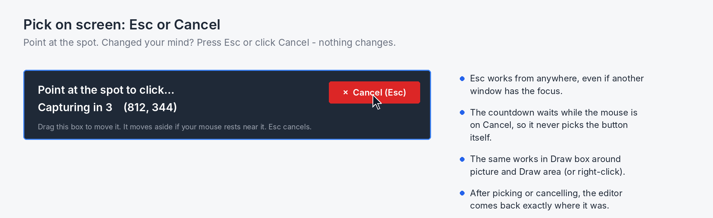

**Changed your mind?** Press **Esc** (it works from anywhere, even when another program has the
keyboard focus) or click **✕ Cancel (Esc)** on the countdown box. Right-clicking the box also
cancels. Nothing is changed and the editor comes back. The countdown **waits while the mouse is
on Cancel**, so it never picks the Cancel button itself.

The countdown box is designed to stay out of your way: it **moves aside** when your mouse
rests near it for a moment, and you can **drag** it anywhere (the countdown pauses while you
drag).

When you pick, Clickue saves three things, used in this order:

1. **A picture of the spot** (recommended, on by default).
2. **The window** it's in, and where inside that window.
3. **The exact screen position**.

### 1. Finding the spot by its picture

With **Find the spot by its picture** ticked, Clickue searches the screen for the saved
picture before every click. That makes clicks reliable when windows move, the screen
resolution changes, or the display scaling is different (for example one computer at 100 %
and a remote session at 150 %).

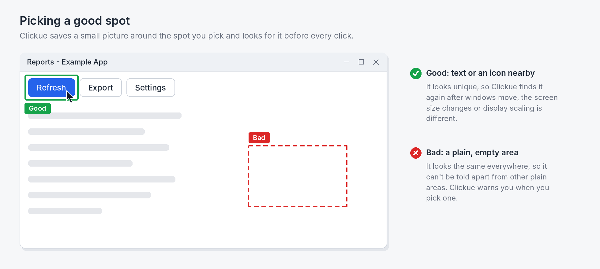

How the search works:

- It looks at sizes from **50 % to 200 %**, so it handles different resolutions and display
  scaling from 100 % to 175 %. It remembers the size it last found, so later checks are faster.
- It compares the **whole picture** and a **close-up of the exact spot**, so it can tell the
  right button from look-alikes.
- With **Only the exact picture** (on by default, below) a similar-looking picture is never
  used, and if the exact picture appears **more than once**, only the copy **where you picked
  it** is used. If it can't tell which copy you picked, it doesn't click.
- If the spot is **plain** (an empty area that looks the same everywhere), Clickue **warns**
  you when you pick it. Pick a spot with text or an icon nearby instead.

### Only the exact picture

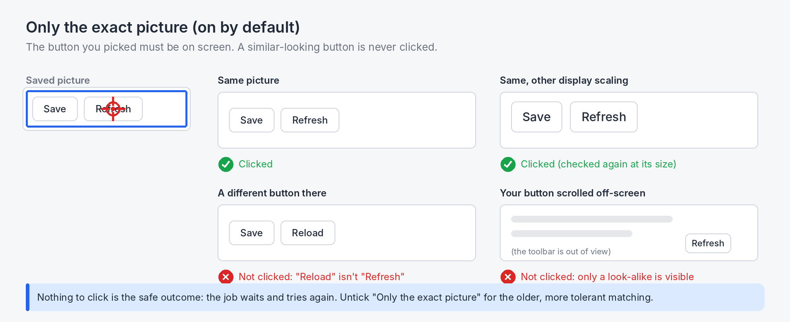

**Only the exact picture** (in the editor, under the picture; **on** by default, also for jobs
made with older versions) makes sure Clickue clicks **the thing you picked and nothing else**:

- At the size you picked it, the picture must match **almost pixel for pixel**, including the
  close-up of the spot and the colours. A button that merely looks similar (another button in
  the same style, *Reload* instead of *Refresh*, a different icon in the same place) doesn't
  count.
- At another size (different display scaling or a remote session), the place found is
  **scaled back to the picture's size and compared again**, close-up included, so a resized
  look-alike doesn't count either.
- If your button is **off the screen** (scrolled away, a window covering it, minimized) and
  only something similar is visible, **nothing is clicked**. The job waits and tries again,
  like any other "can't click right now" situation, and the log says *couldn't find the exact
  picture on screen (… similar places ignored)*.
- If the **exact same picture is on screen several times** (a row of identical icons), the copy
  **at the place you picked** is used. If none of them is there (the window moved), nothing is
  clicked: *the exact picture is on screen N times and Clickue can't tell which one you
  picked*. Pick a **Large** picture (it includes the surroundings, which usually differ), or
  use **Inside a window** so the saved place moves with the window.

Untick **Only the exact picture** to get the older, more tolerant matching: similar pictures
count, and among look-alikes the one closest to where you picked is used. Use it only when the
spot's look changes a little on purpose (for example a counter or a timestamp inside the
picture) and there's nothing similar nearby that must never be clicked.

**Click steps** have the same option (**Only the exact picture**, on by default) under *By its
picture*. Screen watchers always compare their watched picture strictly ([section
6](#strict-matching)).

**Picture size.** Choose how much of the screen around the spot is saved. It applies the
next time you pick.

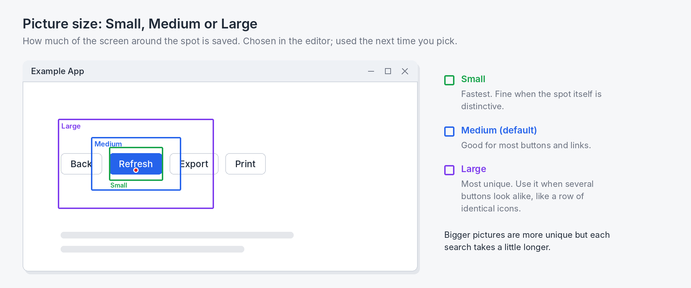

| Size | Area saved | Use when |
|---|---|---|
| Small | 90 × 56 | The spot itself is distinctive; fastest |
| **Medium** (default) | 150 × 90 | Most buttons and links |
| Large | 260 × 150 | Several buttons look alike (a row of identical icons, repeated "Open" links) |

**If the picture can't be found:**

- **Wait and retry** (default, safest). Clickue doesn't click, logs *picture not found*, and
  tries again, like any other "can't click right now" situation.
- **Click the saved position.** Falls back to the window or screen position. Use it only
  when the layout never changes.

> [!TIP]
> Re-pick a spot whenever the app it's in changes its look (a redesign, a new theme, dark
> mode). The saved picture is how the spot is found.

### 2. Inside a window

When you pick inside an app's window, Clickue also remembers **which window** (by its title)
and **where inside it**. The editor then selects **Inside a window**:

- **Window title contains.** Part of the title used to find the window. If the title changes
  (for example it includes a document name or a count), keep only the part that stays the
  same: `Example App` instead of `Inbox (12) - Example App`.
- **Spot inside the window X / Y.** The position inside the window's content area.
- **Bring the window to the front before clicking** (on by default), so nothing covers it.
- **Adjust the spot if the window changes size.** Scales the position when the window is
  resized. Good for layouts that stretch; leave it off for fixed layouts.

### 3. Fixed screen position

The simplest option: the exact pixel on the screen (**Screen X / Y**). You can type the
numbers yourself.

- **Adjust the spot if the screen resolution changes** scales the position with the screen.
- If the screen size is different from when you picked the spot, the editor warns you.

### Checking a spot

**Show spot** (in the editor, the Tests window, or the right-click menu) moves the mouse to
where Clickue would click **right now**, shows a pulsing crosshair, and tells you how it found
the spot, e.g. *exact picture 100%* or *exact picture 93% at 150% size*. It never clicks. See
[section 10](#10-testing-a-job).

- **How long the marker stays.** 5 seconds by default. Change it in **Preferences → Clicking →
  Keep the marker on screen for** (1 to 120 seconds). Click the marker or press **Esc** to close
  it sooner. The same setting applies to a watcher's **Check now**.
- **Point out every similar picture.** Turn on **Preferences → Clicking → Also point out every
  similar picture on the screen at the same time** (off by default) to see, together with the
  crosshair, an outline around **everything that looks like your picture**, each labelled with
  how closely it matches:

  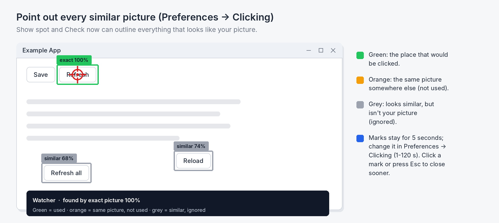

  - **Green**: the place that would be clicked.
  - **Orange**: the same picture somewhere else (not used).
  - **Grey**: similar, but not your picture (ignored).

  When the picture isn't found, the outlines still show what Clickue saw, so you can tell why
  (for example, only look-alikes are on screen).
- When everything is back, the windows return **exactly** where and how big they were.

**Scenario: the same job from two different screens.** You set up a job while sitting at the
computer, but later connect to it by remote desktop at a different resolution. With **Find the
spot by its picture** on, Clickue finds the button at its new size and position, so the job
keeps working without being re-picked.

---

## 5. Scheduled clicks

Click **＋ New click** (Ctrl+N).

### The settings

| Setting | What it does | Default |
|---|---|---|
| **Name** | Shown in the list, the log, history and alerts | *Click 1* |
| **Where to click** | The spot ([section 4](#4-choosing-where-to-click)). Untick **Start with a click on this spot** for a job that only runs its steps | — (on) |
| **Click** | Left, right or middle; single or double | Left, single |
| **Scheduled every** | Hours, minutes and seconds between clicks | 8 h |
| **Add a random delay after each scheduled time** | Adds a random wait so clicks don't happen at a predictable moment | On |
| **Random delay from / up to** | The range of the random delay, chosen fresh each time, to the second | 10 s to 15 min |
| **First scheduled time** | A time of day (24 h, `HH:MM`) for the first click. Blank = one interval from now | Blank |
| **Keep a fixed schedule** | Random delays don't push later clicks later | On |
| **When it may run** | Active hours and limits ([section 7](#7-when-a-job-may-run-active-hours-and-limits)) | Off |
| **Steps** | Steps after the click ([section 8](#8-steps-and-workflows)) | None |
| **Run options** | Priority, letting other jobs go first, screen video, failure screenshots, a time limit per run ([section 11](#11-starting-pausing-stopping-and-taking-turns)) | Normal, off, off, off, 6 h |
| **Start this schedule when I save** | Starts the job right away | On for new jobs |

Under the settings, a one-line **summary** describes what the job will do, e.g. *Clicks every
8h, each one 10s to 15m after its scheduled time (random, to the second).*

### How the random delay and the fixed schedule work

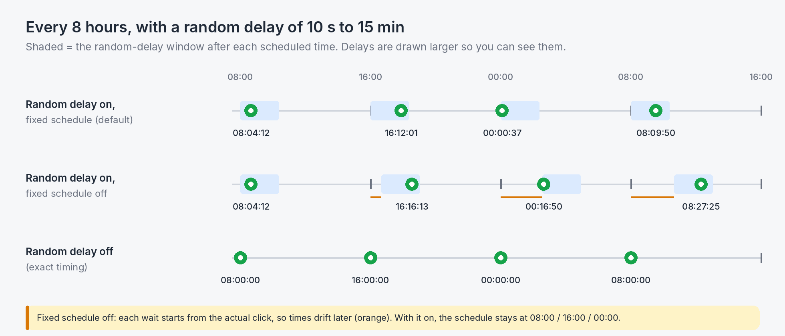

- **Random delay on, fixed schedule on (default).** The *scheduled* times stay at exactly
  08:00, 16:00, 00:00… and each click happens a random 10 s to 15 min after its scheduled time.
  Over days and weeks, the clicks never drift.
- **Fixed schedule off.** Each interval counts from the **actual** click, so the delays add up
  and the times slowly drift later. Use this only if you want "at least 8 hours between
  clicks".
- **Random delay off.** Clicks happen at exactly the scheduled times.

If a scheduled time is missed completely (see below), the next one is the next slot on the
same fixed schedule. Old slots aren't "caught up".

### Missed clicks

If a click comes due but can't happen (the screen is locked or the remote session is
disconnected, you're using the mouse, the spot is covered or can't be found), Clickue:

1. shows **Waiting** and retries every 30 seconds,
2. keeps trying for **15 minutes** (change it in **Preferences → Clicking**),
3. then records **Missed** in *Last result* and the history, sends an alert if you've turned
   that on, and moves on to the next scheduled time.

A click that came due **while Clickue was closed** is skipped, not fired late the moment
you start it again.

### Scenarios

- **Refresh a page every 30 minutes, not like clockwork.** Scheduled every 0 h 30 min, random
  delay 10 s to 3 min. Each refresh lands somewhere in the first three minutes of its slot.
- **Every morning at 08:00 exactly.** Scheduled every 24 h, random delay **off**, First
  scheduled time `08:00`.
- **Keep a session alive.** Click a harmless spot (a page title or a blank part of a toolbar)
  every 10 minutes; add active hours so it only runs during the working day.
- **A daily report.** Every 24 h starting at 07:30, with extra steps that click *Export* and
  then *Save* (see [the chain recipe](#recipe-3-refresh-export-and-save-a-report)).

---

## 6. Screen watchers

A watcher looks at the screen every so often and clicks **when a picture disappears** or
**when it appears**. Click **👁 New watcher** (Ctrl+Shift+N).

### When a picture disappears

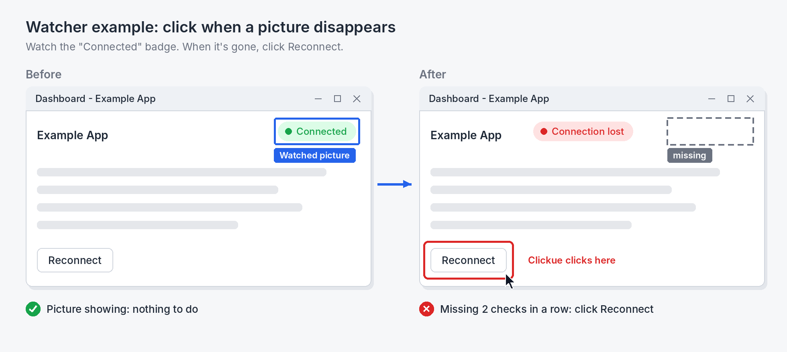

Use this when something is **normally on screen** and its absence means something went wrong:
a *Connected* badge, a *Live* indicator, a green status light, a "logged in as…" label.

### When a picture appears

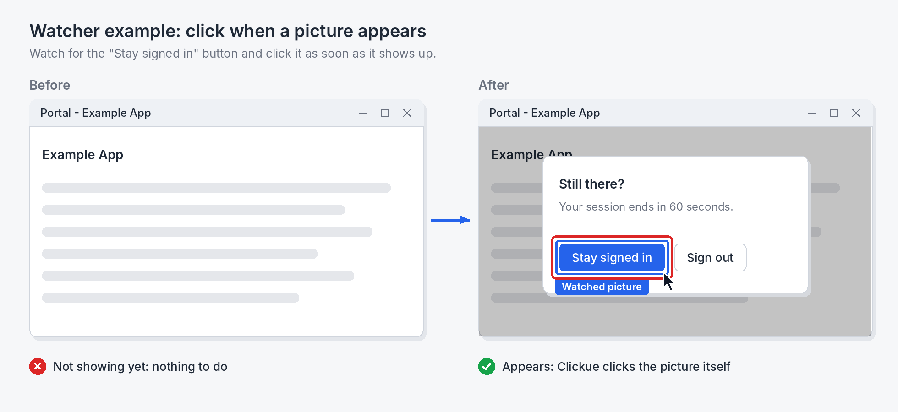

Use this when something **shows up** and needs a click: a *Continue* button, a *Stay signed in*
prompt, an *OK* on a message box, a *Retry* banner.

Tick **Click the picture itself (where it's found)** when the thing that appears is the button
to press. Clickue then clicks where it found the picture, and you don't need to pick a separate
button.

### Setting up a watcher, step by step

1. **Click** *when the picture disappears* or *when the picture appears*.
2. **▢ Draw box around picture…** The screen freezes and dims. Drag a box around what to
   watch, then release. The size shows while you drag. **Esc**, a right-click, or the
   **✕ Cancel (Esc)** button next to the instructions cancels.
   - Draw it **while the picture is on screen** (for "appears" watchers, open the dialog or
     prompt once so you can draw it).
   - Box something **distinctive**: text, an icon, a logo. Clickue warns you about plain areas
     and very big boxes (big boxes work, but each check is slower). The box must be at least
     8 × 8 pixels (since 4.5.4; it was 16 × 16).
   - **Zoom in for small pictures** ([below](#zooming-in-while-you-draw)): the mouse wheel
     magnifies the frozen screen up to 24×, and a magnifier next to the pointer shows the exact
     pixels, so you can put the box's edges on exactly the right pixel.
   - The picture is saved at **full screen resolution** (lossless, never scaled down), with the
     mouse pointer moved aside for a moment so a hover highlight isn't saved with it.
   - A moment later Clickue looks at the same box again. If part of it **changed** (a number,
     a clock, an animation), it warns you: with **the exact picture** the watcher would think
     the picture is gone each time that part changes. Draw a smaller box around a part that
     stays the same, or choose **part of the picture is enough** (below).
3. **Search** the whole screen, or **only an area** (below).
4. **Match** **the exact picture** (default) or **part of the picture is enough** (below).
5. **Button to click.** **◎ Pick on screen…** the button to press. (Not needed when *Click the
   picture itself* is ticked, or when you untick **Click a button when this happens** so the
   watcher only runs its steps.)
6. Set the timing: **Check every**, **Click when missing/showing for … checks in a row**, the
   optional **random delay**, the optional **wait after each click**, and **Click only once**.
   All explained below.
7. **Check now** confirms the picture can be found right now and marks it on the screen (for 5
   seconds, or what you set in **Preferences → Clicking**; with **point out every similar
   picture** on, look-alikes are outlined too). **Show spot** does the same for the button.
   **Dry run** shows the picture, then the button, and says whether it would click. None of
   them clicks, and the editor comes back exactly where it was.
   When the picture isn't found, the message and the test history say how close the best
   place came, and **Dry run** outlines the closest places on screen so you can see why.
8. **Save.** Leave **Start watching when I save** ticked to start right away.

### Zooming in while you draw

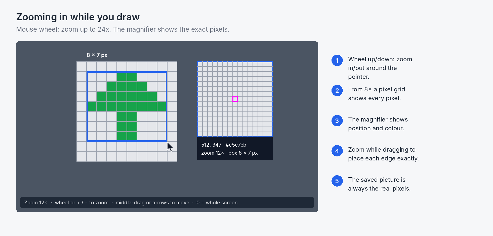

Every *Draw box* screen (watchers, *Wait for a picture* steps, If/Repeat picture conditions,
video hidden areas) can zoom:

| Do | To |
|---|---|
| **Mouse wheel** up / down, or **+** / **−** | Zoom in / out around the pointer: 1×, 2×, 3×, 4×, 6×, 8×, 12×, 16×, 24× |
| **Middle mouse button** drag, or the **arrow keys** | Move around the zoomed screen (**Shift+arrow** moves one pixel) |
| Drag near the edge while drawing | The view follows |
| **0** | Back to the whole screen |
| **Esc**, right-click or **✕ Cancel** | Cancel |

- From 8× a **pixel grid** is drawn, so you see every pixel.
- The **magnifier** next to the pointer always shows the 15 × 15 pixels around it, the pixel
  under the pointer outlined, its **screen position** and **colour** (e.g. *#1e5ac8*), the
  zoom, and while drawing the box size.
- You can zoom in or out **while** dragging: start the box zoomed out, zoom in at the far
  corner, and release exactly where you want.
- Zooming only changes what you see. The saved picture is always the **real pixels** of the
  screen at full resolution; the size shown (*37 × 22 px*) is its real size.

### Search only an area

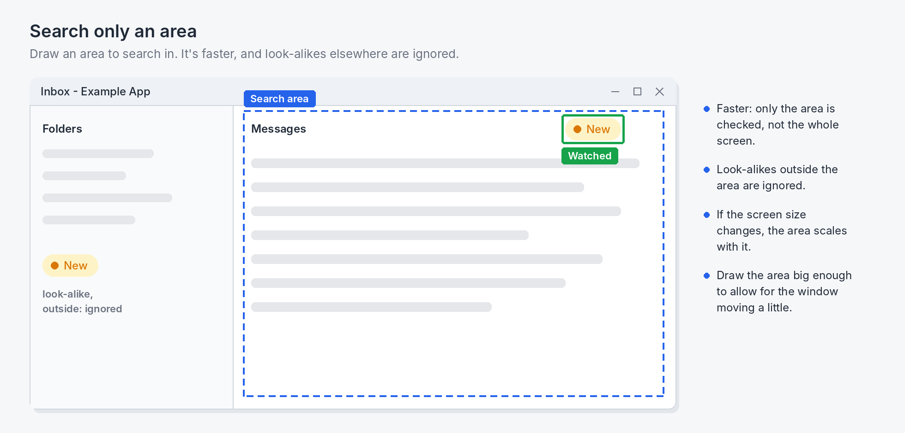

Choose **only an area:** and **Draw area…** to limit where Clickue looks. This is:

- **faster**, because only that part of the screen is checked, and
- **more precise**, because look-alikes elsewhere on the screen are ignored.

The area scales with the screen if the resolution changes. Since 4.5.3 Clickue searches the
area **with a small margin** (a quarter of the picture's size, at least 24 pixels, on every
side, and always at least the picture's own size), so a picture that touches the edge of the
area, or an area drawn tightly around the picture itself, still counts. Before 4.5.3 an area
drawn even a few pixels smaller than the watched picture made the watcher report the picture
as missing. Drawing the area a bit bigger than the panel is still a good habit.

### Strict matching

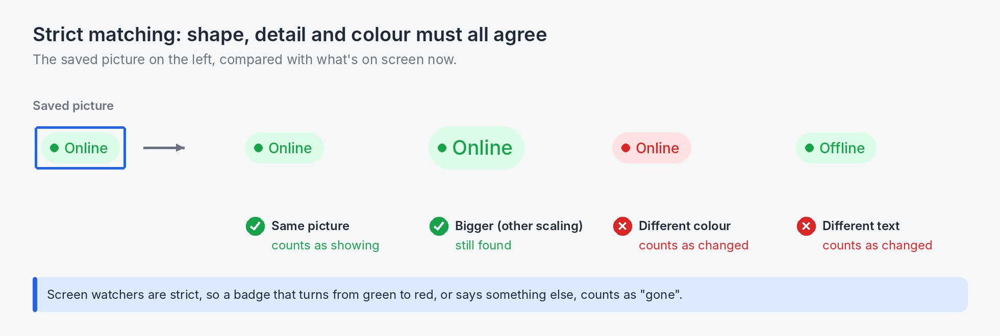

Watchers compare **shape, close-up detail and colour**. A badge that turns from green to red,
or whose text changes from *Online* to *Offline*, counts as **changed** (gone), even though
its shape is the same. The same picture at another size (different display scaling) is still
found: since 4.5.1 it's scaled back to the drawn size and compared again, so a resized
look-alike doesn't count as "still there" either.

### Exact or partial matching

Since 4.5.4 both modes look at **every place on the screen** (or the search area), so a picture
that's on screen several times is found **every time**: **Check now** outlines each copy (the
best one gets the marker), and the result says *on screen 3 times*.

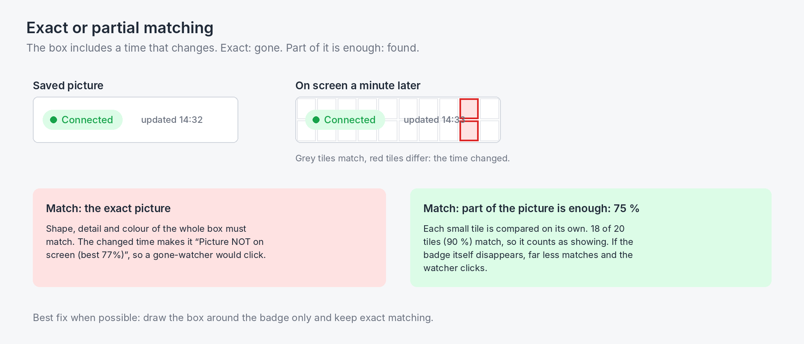

**Match** decides how much of the watched picture has to be on screen:

| Choice | Counts as showing when… | Use it for | Default |
|---|---|---|---|
| **the exact picture** | **every part** of the picture matches: shape, close-up detail and colour, checked tile by tile, so even one changed digit anywhere in the box means "not this picture" | badges, buttons, labels that look the same every time | ✔ |
| **part of the picture is enough: N % of it** | at least N % of the picture matches (40–95 %) | a box that also contains something that changes: a price, a counter, a clock, a blinking cursor | 75 % |

How partial matching works: the saved picture is cut into small tiles (about 24 × 24 pixels).
Each detailed tile is searched for on its own over the whole screen, and every place where
enough tiles line up becomes a candidate, even where the changing part makes the picture as
a whole look quite different. Each candidate is then checked tile by tile: a tile may sit a
few pixels off and must also have the same colour. The share of tiles that match is the
score. *Check now*, *Dry run* and the test
history show it as *82 % of it matches, 75 % needed*. The same target marker shows where
the picture was found, whichever mode you use.

- **Higher** percentages are stricter. At 90 % nearly everything must match; at 50 % half the
  picture may differ, so a different button of the same style may count.
- The part that **doesn't** change must be big enough to tell the picture apart. If the box
  is mostly the changing number, draw a new box instead.
- Exact matching is still the safest choice when you can draw a box around something that
  never changes.

**Scenario.** You watch a *Connected* badge, but your box also caught the *last updated 14:32*
text next to it. With the exact picture the watcher reports *Picture NOT on screen (best
77%)* every minute. Either draw the box around the badge only, or choose **part of the
picture is enough: 75 %**: the time may change, but if the badge itself disappears, far less
than 75 % matches and the watcher clicks.

### The mouse pointer on the picture

Hovering the mouse over a button often changes how it looks (lighter, outlined, underlined).
Since 4.5.3:

- **Draw box** saves the picture with the pointer moved aside for a moment.
- **Check now**, **Dry run** and scheduled watcher tests: if the picture isn't found while the
  pointer rests on it (or on the search area), Clickue looks again with the pointer moved
  aside for a moment and puts it back. The result says *checked again with the mouse pointer
  moved aside*.
- **A running watcher** does the same only when nobody has used the computer for 20 seconds
  and no job is clicking. While you're using the mouse right on the picture, the check isn't
  counted as *missing* (the list shows *Can't tell: mouse pointer on the picture*, and the
  Activity log says so once). It counts again as soon as the pointer moves away.

### Timing settings

| Setting | What it does | Default |
|---|---|---|
| **Check every** | How often to look | 30 s |
| **Click when missing for** (or **showing for**) **N checks in a row** | Flicker protection: the change must be seen this many times in a row | 2 |
| **Wait a random delay before clicking** | A random pause before the click | On, 1–5 s |
| **Wait a while after each click before looking again** | Gives the app time to react before the next check | On, 30 s |
| **Click only once each time it disappears / appears** | Don't click again until the picture has come back (or gone away) | On |

New watchers start with the **Check every** and **checks in a row** values from
**Preferences → Watchers**.

**Flicker protection.** Screens flicker: a page reloads, a tooltip covers something for a
moment. Requiring the change for several checks in a row ignores these blips. Once a change
is first seen, the confirming checks come quickly (every 5 seconds), so a real change is still
handled fast.

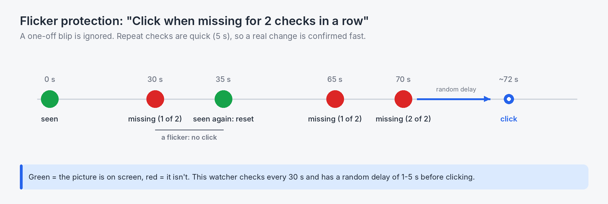

**Click only once.** With it on, the watcher clicks **once** per change and then waits for the
picture to come back (or go away) before it will click again. With it off, it keeps clicking
for as long as the change lasts, waiting the *after each click* time between clicks.

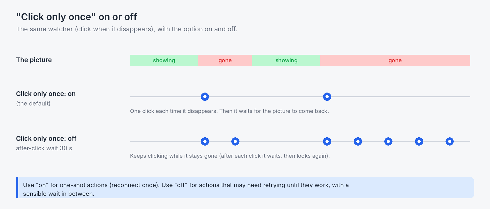

Example with *click when it disappears* and **click only once on**: the picture is there, so
nothing happens. The picture goes away, so Clickue clicks once. The picture comes back, which
re-arms the watcher (no click). The next time it goes away, Clickue clicks once again.

### Clickue's own window

While the Clickue window is **open on screen**, a *missing* picture isn't counted, because the
window might be covering it. The list shows *Can't tell: Clickue window open*. Minimize Clickue
or send it to the tray when you've finished setting up. "Appears" watchers aren't affected.

### Watcher statuses

**Watching** (*Seen 13:49:58* or *Not showing*), **Missing** / **Showing** (confirming a change),
**Clicking** (during the random delay), **Off hours**, and **Paused**. The countdown shows
*check in 12s*.

### Scenarios

- **Reconnect after a drop.** Disappears: the *Connected* badge. Button: *Reconnect*. Check
  every 30 s, 2 checks, click only once on.
- **Dismiss a recurring prompt.** Appears: the prompt's *OK* button. Click the picture itself.
  Check every 10 s, 1 check.
- **Keep a dashboard on its live view.** Disappears: the *Live* label (it vanishes when the page
  falls back to a paused view). Button: the *Live* toggle.
- **Retry until it works.** Appears: the *Retry* button. Click the picture itself. Click only
  once **off**, wait 60 s after each click, so it keeps pressing *Retry* every minute while the
  banner stays.
- **Watch one panel among several identical ones.** Search only an area around the panel you
  care about, so the same badge in another panel is ignored.
- **Watch a status next to a changing value.** The box catches a status label and a number
  that updates every few seconds. Match **part of the picture is enough: 75 %**, or draw the
  box around the label only.

---

## 7. When a job may run: active hours and limits

Every job's editor has a **When it may run** section.

### Active hours and days

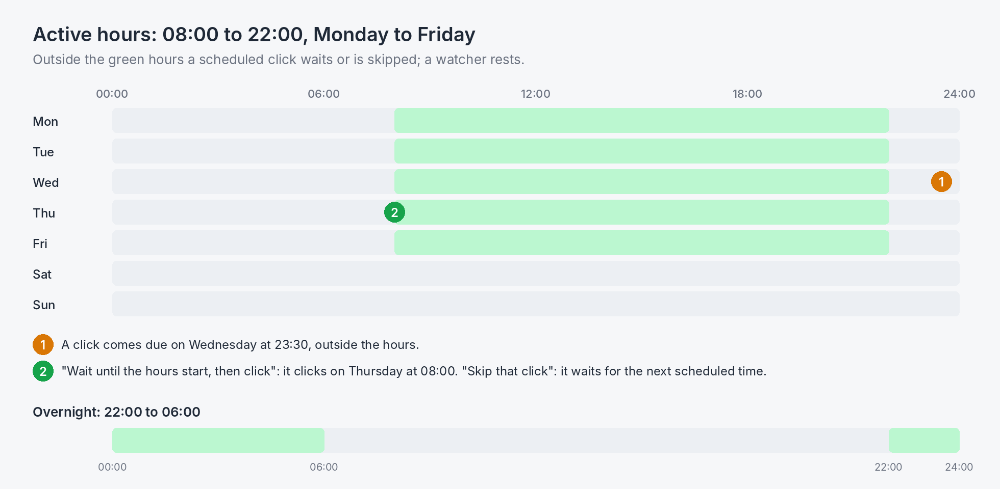

Tick **Only run during set hours and days**, set **From** and **to** (24 h), and tick the days.

- **Overnight** ranges work: `22:00` to `06:00` runs from 10 pm until 6 am.
- **The same time twice** (e.g. `00:00` to `00:00`) means all day on the ticked days.
- **Scheduled clicks:** *If a click comes due outside these hours*:
  - **Wait until the hours start, then click.** The click happens at the start of the next
    active period.
  - **Skip that click.** It's dropped, and the job waits for its next scheduled time.
- **Watchers** don't look or click outside the hours; the list shows **🌙 Off hours** and when
  the job is active.

### Limits

- **Stop after N clicks**, counted from when the job is started (or restarted).
- **Stop at** a date and time, `YYYY-MM-DD HH:MM`.

When a limit is reached, the job **stops**, *Last result* shows **Finished** with the reason,
and an alert is sent if *A job finished* is ticked in **Preferences → Phone alerts**.

### Scenarios

- **Office hours only.** 08:00 to 18:00, Mon–Fri. A click due on Saturday waits until Monday
  08:00, or is skipped.
- **Only at night.** 22:00 to 06:00 every day, for a task that shouldn't disturb daytime work.
- **A one-week trial.** Stop at next Friday 17:00.
- **Just a few times.** Stop after 3 clicks, e.g. to retry something three times and then give
  up.

---

## 8. Steps and workflows

After its main click, any job (scheduled click or watcher) can run **steps**, in order. A job
can also be **steps only**: untick **Start with a click on this spot** (watchers: **Click a
button when this happens**) and the job just runs its steps, for example a recorded macro
([section 9](#9-recording-a-macro)). Steps live in the editor's **Steps** list, the job's
**timeline**.

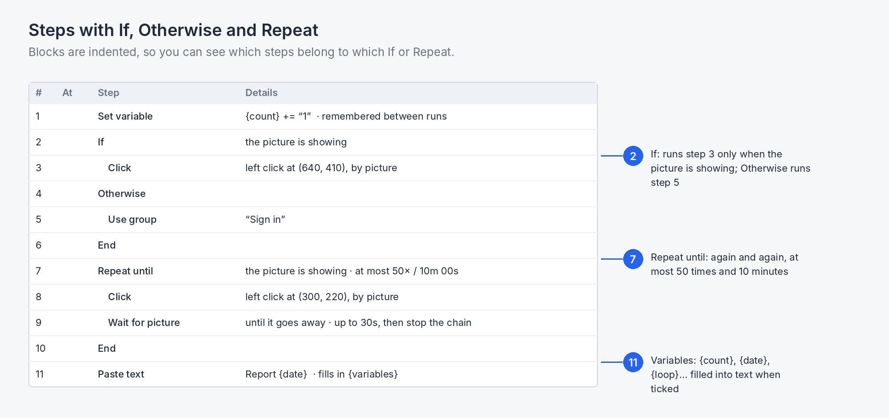

### Step types

Click **＋ Add step ▾** and choose a type. The new step goes **after the selected step** (or at
the end).

| Step | What it does | Settings |
|---|---|---|
| **Click a spot** | Clicks somewhere | **◎ Pick on screen…** (also saves a picture), **Picture of this spot now**, the button (left/right/middle), single/double, and **how to find the spot**: by its picture (recommended), inside a window, or a fixed screen position ([below](#how-a-step-finds-its-target)) |
| **Wait** | Waits | From … to … seconds (decimals allowed, e.g. 0.5). The same number twice waits exactly that long; two different numbers wait a random time in that range |
| **Wait for a picture** | Waits until a picture **appears** or **goes away** | The picture (**▢ Draw box around picture…**); for "appears": **then click it** with a button and single/double; **Wait up to** 1 s to 1 h (default 60 s); if it doesn't happen: **stop the chain** or **continue anyway** |
| **Type text** | Presses one key per character into whatever has focus | Text (up to 20,000 characters; a new line presses Enter), **Fill in {variables}**, **Secret** ([Type or paste?](#type-text-or-paste-text)) |
| **Paste text** | Puts text on the clipboard, presses Ctrl+V, puts your clipboard back | Text (up to 200,000 characters, several lines, any language), **Paste with** Ctrl+V / Shift+Insert / Ctrl+Shift+V, **Put back what was on the clipboard afterwards**, **Wait after pasting**, **Fill in {variables}**, **Secret** |
| **Press keys** | A key or a combination | E.g. `Enter`, `Tab`, `Ctrl+S`, `Ctrl+Shift+S`, `Alt+F4`; **times** (1–100) to press it several times |
| **If (condition)** | Runs the steps up to **End** only when a condition is true; an **Otherwise** step inside runs other steps when it isn't | The condition ([below](#if-otherwise-and-end)) |
| **Repeat** | Runs the steps up to **End** again and again | **N times**, or **until** a condition is true, at most N times and S seconds |
| **Set a variable** | Stores a value for later steps | Name, **set to / add / subtract**, value, **Remember it for the next run** |
| **Use a step group** | Runs a saved group of steps | The group ([Step groups](#step-groups)) |
| **Scroll** | Turns the mouse wheel | Notches, direction (down/up/left/right), optionally **point at a spot first** |
| **Drag** | Presses a button, moves along a path, lets go | Start, end, how long it takes (recorded drags keep their path) |
| **Move the mouse** | Moves the pointer along a path, no click | Start, end, how long (useful for menus that open on hover) |
| **Mouse button down / up** | Presses and holds, or lets go of, a mouse button | Button, optionally at a spot |
| **Hold a key down / let go** | Holds a key such as Shift or Ctrl, e.g. for Shift+click | The key; down or up |

**Key names** for *Press keys* and *Hold a key*: Ctrl, Alt, Shift, Win, Enter, Tab, Esc,
Space, Backspace, Delete, Insert, Up, Down, Left, Right, Home, End, PageUp, PageDown, F1–F24,
Num0–Num9, PrintScreen, Pause, CapsLock, Menu, letters and digits, or a Windows key code such as
`0xBA`. Combine them with `+`.

**Every step** also has, under **This step**:

| Option | What it does | Default |
|---|---|---|
| **Name** | Shown in the timeline, e.g. *Open report* | Empty |
| **If it fails, try again N more times, waiting S s in between** | Retries a step that didn't work (e.g. a target not found yet) | 0 times, 2 s |
| **If it still fails** | **stop the job's run** (safe) or **continue with the next step** | Stop |
| **⚠ Careful step** | Mark steps that send, delete or buy. **Step through** always stops before them | Off |

### Editing the timeline

- **Edit** (or double-click), **Duplicate**, **Remove** (Del), **▲ / ▼** to move. Select several
  steps (Ctrl- or Shift-click) to move, duplicate or remove them together.
- **More ▾**: make all waits **shorter (× 0.5)** or **longer (× 2)**, **remove waits shorter
  than 0.5 s**, **remove mouse movements**, and **save selected steps as a group**.
- Blocks are **indented**: the steps between *If* and *End*, or *Repeat* and *End*, are shifted
  right so you can see what belongs where. Adding an *If* or *Repeat* adds its *End* for you;
  move steps between them with ▲ ▼.
- If the blocks don't match (an *End* too many, an *If* without *End*), a ⚠ line under the list
  says which step, and the job can't be saved until it's fixed.
- The **At** column shows when a recorded step happened in the recording.
- **Dry run** and **Step through…** at the bottom of the editor test the job as it is in the
  editor, before you save ([section 10](#10-testing-a-job)).

### How a step finds its target

A **Click a spot** step (and every job's main click) is found in one of three ways. The step
editor shows which one, and what happens if the target isn't there, under *Targeting*:

| Way | What Clickue checks before clicking | If it isn't found |
|---|---|---|
| **By its picture** (recommended) | Searches the screen for the saved picture. With **Only the exact picture** (on by default) a similar-looking picture never counts ([section 4](#only-the-exact-picture)) | Nothing is clicked. The step fails (and can retry) |
| **Inside a window** | Finds the window by its title, uses the spot inside it, checks nothing covers it | Nothing is clicked |
| **Fixed screen position** | Only that Clickue's own window isn't covering it. **Not verified**: only for things that never move | — |

Clickue never quietly switches to an unchecked position when a picture isn't found. (The job
editor's **If the picture can't be found → Click the saved position** option does that, but only
because you chose it, and the log says so each time.)

To turn a recorded fixed-position click into a checked one: open the step, make sure the
screen shows what you want to click, and press **Picture of this spot now** (or **◎ Pick on
screen…**). For a window: **Use the window at this spot**.

> [!NOTE]
> Finding text on screen (OCR), Windows UI Automation controls and browser elements are
> **planned**, not available yet. They'll plug into the same "how a step finds its target"
> choice.

### Type text or Paste text?

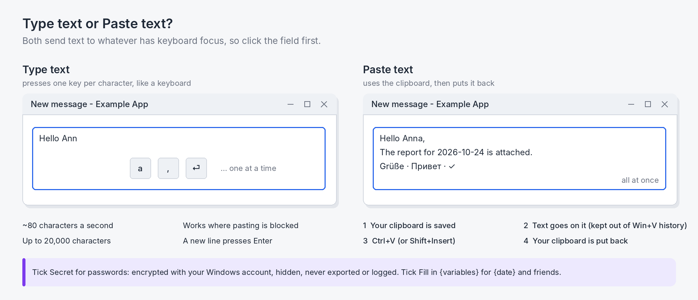

| | **Type text** | **Paste text** |
|---|---|---|
| How | Presses one key per character, like a keyboard | Puts the text on the clipboard, presses Ctrl+V (or your choice), then puts your clipboard back |
| Speed | About 80 characters a second | Instant |
| Best for | Short text; fields that block pasting; programs that react to each key | Long text, several lines, any language or symbols, exact formatting |
| Limit | 20,000 characters | 200,000 characters |

Both send the text to **whatever has keyboard focus**. Add a **Click a spot** step on the
field first (and a short **Wait** if the field takes a moment to appear).

**The clipboard.** Paste saves what was on your clipboard, pastes, waits **0.3 s** (change it with
*Wait after pasting* for slow programs), then puts it back. Text, pictures copied as images and
most other formats are restored. If the clipboard held something Clickue can't copy (rare
drawing formats), the log says it was **only partly put back** or **cleared**, rather than
leaving your pasted text there. Pasted text is marked so Windows keeps it **out of clipboard
history (Win+V) and cloud clipboard sync**. Untick *Put back what was on the clipboard
afterwards* if you want the text to stay on the clipboard.

**Secret text.** Tick **Secret** for passwords or codes. The text is then encrypted with your
Windows account (it can only be read by you, on this computer), hidden in the timeline, **never
exported**, never logged, and the run's video is blacked out while it's entered. On another
computer or account, a secret step says *enter it again*. Without Secret, text is saved in your
jobs file as written.

**Variables in text.** Tick **Fill in {variables}** to replace names in braces, e.g.
`Report {date}.csv` → `Report 2026-10-24.csv` ([Variables](#variables)). Without the tick, text is
typed or pasted exactly as written, braces included (so older jobs behave as before).

Text from Type and Paste steps is **never** written to the log, click history, run history or
error messages; only the number of characters is.

### Variables

| Variable | Value |
|---|---|
| `{date}` `{time}` `{datetime}` | 2026-10-24 · 14:05:07 · 2026-10-24 14:05:07 |
| `{year}` `{month}` `{day}` `{hour}` `{minute}` `{weekday}` | Parts of the date and time (`{weekday}` = Mon…Sun) |
| `{job}` | The job's name |
| `{run}` | Which run this is (1, 2, 3…) |
| `{loop}` | The current pass of the innermost **Repeat** (1, 2, 3…) |
| Your own | Whatever a **Set a variable** step stored, e.g. `{count}` |

**Set a variable**: *set to* a value (which may itself use variables, e.g. `{date}-{count}`), or
*add* / *subtract* a number. Tick **Remember it for the next run** for counters that keep going
up from run to run. `{{` and `}}` give a literal brace. Names use letters, digits and `_`.

### If, Otherwise and End

An **If** step checks a condition **once** (or keeps checking for up to *Wait up to* seconds),
then runs the steps under it, or the ones under **Otherwise**:

| Condition | True when |
|---|---|
| **a picture is showing** / **a picture is NOT showing** | The picture you drew is (not) on screen |
| **a window is open** / **a window is NOT open** | A window whose title contains the text is (not) open |
| **a variable has a value** | `{name}` compares with a value: `==`, `!=`, `<`, `>`, `<=`, `>=` (numbers compare as numbers), or `contains` |

Example: *If a picture is showing (the "Unsaved changes" banner) → click Save; Otherwise →
(nothing); End.*

### Repeat … End

- **Repeat N times** (up to 10,000). `{loop}` counts the passes.
- **Repeat until** a condition is true, **at most N times and S seconds** (defaults 100 times,
  600 s). If the condition never comes true, the step fails with *the condition didn't come true
  after … time(s)*, unless you set it to *continue with the next step*.

Loops can't run forever: every Repeat has its limits, every job run has a **time limit**
(**Run options → Stop a run that takes longer than**, default 6 hours), and one run can do at
most 200,000 steps.

### Step groups

A **step group** is a saved set of steps you can use in several jobs, e.g. *Sign in* or *Close
pop-ups*. Change it once, and every job using it gets the change.

- **Make one:** select steps in a timeline → **More ▾ → Save selected steps as a group…**.
  Clickue offers to replace them with one **Use a step group** step. Or ☰ Menu → **Step
  groups… → New**.
- **Use one:** **＋ Add step ▾ → Use a step group**.
- **Manage:** ☰ Menu → **Step groups…** shows each group, its steps and which jobs use it.
  Deleting a group that's in use warns you; those steps then fail with a clear message.
- Groups can't contain other groups, so they can never call themselves. They're exported along
  with the jobs that use them.

### When a step fails

The step is retried if you asked for it, then either the run **stops** (default) or
**continues**, as set for that step. When the run stops, the reason appears in Activity, the
click history, the run history and (if you've turned it on) an alert, e.g. *extra steps stopped
(step 2: timeout - the picture didn't appear within 1 min)*. The main click still counts.

Whenever a run ends (finished, failed, stopped by you, time limit, Clickue closing), Clickue
**lets go of any keys and mouse buttons** its steps were holding down.

### A multi-step job

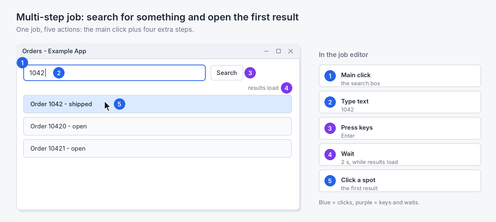

1. Main click: the **search box**.
2. **Type text:** `1042`
3. **Press keys:** `Enter`
4. **Wait:** 2 s
5. **Click a spot:** the first result

### Click chains: react to each click

Fixed waits are guesses. Too short and the next click lands before the app is ready; too long
and time is wasted (and on a slow day, even a long wait may not be enough). **Wait for a
picture** waits for the **actual result** instead, so each step reacts to the one before.

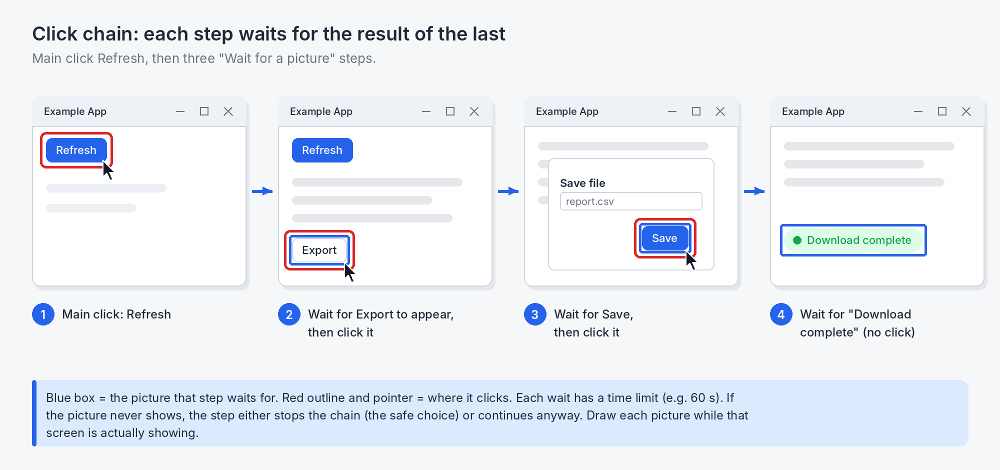

1. Main click: **Refresh**.
2. **Wait for a picture:** the **Export** button → *appears* → *then click it* → up to 60 s →
   *stop the chain*.
3. **Wait for a picture:** the **Save** button → *appears* → *then click it* → up to 30 s.
4. **Wait for a picture:** the "Download complete" message → *appears* (no click) → up to
   120 s. This confirms the chain worked; if it times out, you'll see it in Activity.

**How to set one up**

- Draw each picture **while that screen is actually showing**. Walk through the routine by hand
  once, adding each step as you reach its screen (or record it and replace the waits).
- Use **appears + then click it** for buttons that show up after the previous step.
- Use **goes away** to wait for something to finish, e.g. until a *Loading…* spinner
  disappears, before the next step.
- Use **stop the chain** when later steps make no sense without this one (the safe default).
  Use **continue anyway** for optional screens, e.g. a "What's new" pop-up that only appears
  sometimes, or better: an **If a picture is showing** block.
- Start the chain **on a schedule** (a scheduled click) or **from a change** (a screen watcher).

> [!IMPORTANT]
> While a chain waits, **other jobs wait their turn**, because the mouse can only do one thing
> at a time ([section 11](#11-starting-pausing-stopping-and-taking-turns)). Watchers keep
> watching meanwhile, and a job that's due clicks right after the chain finishes. Keep time
> limits sensible, or tick **Run options → While its steps are waiting, let other jobs click in
> between** for chains that wait a long time.

### Scenarios

- **Recover in several steps.** A watcher sees an error banner appear → clicks *Retry* → waits
  for the *Sign in* button → clicks it → waits for the main page to come back.
- **Confirmation dialogs.** Click *Submit* → wait for "Are you sure?" → click *Yes* → wait for
  the success message. Mark *Yes* as ⚠ careful.
- **Fill a short form.** Click the first field → type → press Tab → type → press Enter.
- **Wait for loading to finish.** Click *Run* → wait until the *Working…* spinner goes away
  (up to 5 minutes) → click *Results*.
- **Only if needed.** *If a picture is showing* (a "Session expired" message) → click *Sign in*
  → *End* → continue with the routine.
- **Work through a list.** *Repeat until a picture is showing* ("No more items", at most 50
  times): click the first row → click *Done* → wait for the row to disappear → *End*.
- **Name files by date.** *Paste text* `Export {date}.csv` (Fill in {variables} on) into a Save
  dialog's file name box, then *Press keys* Enter.

---

## 9. Recording a macro

Show Clickue a routine once, and it turns your clicks and keys into **steps you can read and
edit**, as a new job.

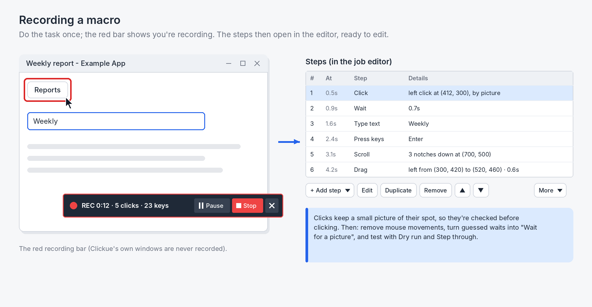

### Recording, step by step

1. Click **⏺ Record** (toolbar), ☰ Menu → **Record a macro…**, or press **Ctrl+Alt+R** from
   anywhere.
2. Choose the options (the hotkey starts straight away with the last options you used):

   | Option | What it does | Default |
   |---|---|---|
   | **Name** | The new job's name | *Recorded macro N* |
   | **Record mouse movement** | Keeps where the pointer went between clicks, simplified to a few points (needed for menus that open on hover) | On |
   | **Save a small picture of each clicked spot** | Each recorded click can find its target by its picture later, even if it moves | On |
   | **Keep the pauses between actions** | Pauses of 0.25 s or more become **Wait** steps you can edit | On |
   | **Pause my other jobs while I record** | So Clickue doesn't click in the middle of your recording | On |

3. **⏺ Start recording.** Clickue hides, counts down 3 seconds, and shows a small **red bar**
   in the bottom-right corner: **● REC** with the time and how many clicks and keys so far.
4. Do the routine at a normal pace.
5. **■ Stop** on the red bar (or **Ctrl+Alt+R** again). **⏸ Pause** (or **Ctrl+Alt+U**) leaves
   out a part, e.g. while you look something up. **✕** throws the recording away.
6. The job editor opens with the recorded steps as a **steps-only** job. It isn't started:
   check the steps, test them, set a schedule, then **Save**. (To use the steps in a watcher,
   select them → **More ▾ → Save selected steps as a group…**, then add **Use a step group** to
   the watcher.)

The emergency stop (**Ctrl+Alt+X**) also throws away a recording in progress.

> [!WARNING]
> **Everything you type is recorded, including passwords.** Don't type secrets while
> recording. Add them afterwards as a **Paste text** step marked **Secret**. Recordings stay on
> your computer, but the steps are saved in your jobs file.

### What is recorded

| You do | It becomes |
|---|---|
| A click | **Click a spot** (with a picture of the spot, if that option is on) |
| Two quick clicks in the same place | One **double click** |
| Right or middle click | A right / middle **Click a spot** |
| Press, hold, release in the same place | **Mouse button down**, **Wait**, **Mouse button up** |
| Press, move, release | **Drag**, with its path |
| Moving the pointer between actions | **Move the mouse** (simplified path), if that option is on |
| Turning the mouse wheel | **Scroll**, with the notches added up |
| Typing letters, digits, spaces and punctuation | **Type text**. Backspace while typing fixes the text instead of being replayed |
| Enter, Tab, arrows, F-keys, Esc… | **Press keys** (repeats become *× N*) |
| Ctrl / Alt / Win combinations (Ctrl+S, Alt+Tab…) | **Press keys** with the combination |
| Shift or Ctrl held during a click or drag | **Hold a key down** … **let go** around it |
| Pressing Win (or Alt) on its own | **Press keys** Win |
| Pauses | **Wait** (rounded to 0.1 s) |

**Not recorded:** Clickue's own windows (including the red bar), anything Clickue itself
clicks or types, and the start/stop hotkeys. Characters made with dead keys (e.g. accents
typed with two keys) or an input method (IME) are recorded as the keys you pressed rather than
as text; check them, or replace them with a *Paste text* step. Coordinates on all monitors are
kept, including monitors to the left of or above the main one.

### Making a recording reliable

A recording replays what you did, at the same places. The screen won't always look the same
next time, so spend a minute on the steps:

1. **Remove what you don't need:** **More ▾ → Remove mouse movements** (unless a menu opens on
   hover) and **Remove waits shorter than 0.5 s**.
2. **Check how clicks find their targets.** Clicks with a saved picture are checked before
   clicking. For a click recorded on a plain area (no picture), open it and use **Picture of
   this spot now** while that screen is showing, or **Use the window at this spot**.
3. **Replace guessed waits with real ones.** Where you waited for a screen to load, change the
   **Wait** into a **Wait for a picture** of the thing that appears.
4. **Mark consequential steps** (Submit, Send, Delete, Buy) as **⚠ careful**.
5. **Dry run** to see that every target is found, then **Step through…** to run it one step at
   a time ([section 10](#10-testing-a-job)).

A recording keeps its size reasonable: mouse movement is simplified to the points that change
its shape (a long, wiggly movement becomes a few dozen points), and one recording can hold up to
300,000 raw events before the bar says it's full.

### Example: record a weekly routine

1. Open the app you use, ready on its start screen.
2. **⏺ Record → Start recording**. Click *Reports*, click *Weekly*, click *Export*, type a file
   name, press Enter. **■ Stop**.
3. In the editor: remove mouse movements; turn the wait after *Export* into **Wait for a
   picture** of the Save dialog; replace the typed file name with **Paste text**
   `Weekly {date}` with **Fill in {variables}** ticked.
4. **Dry run**, then **Step through…**.
5. Set **Scheduled every** 7 days, a **First scheduled time**, tick **Start this schedule when I
   save**, and **Save**.

---

## 10. Testing a job

Open **🧪 Tests** (Ctrl+T, the toolbar, or right-click a job → **Open Tests…**). Pick the job
at the top. **The whole app hides while a test runs** so nothing is in the way, and comes
back with the result: every window returns **exactly** where it was, at the same size (or
maximized, if it was), with the window you were using on top.

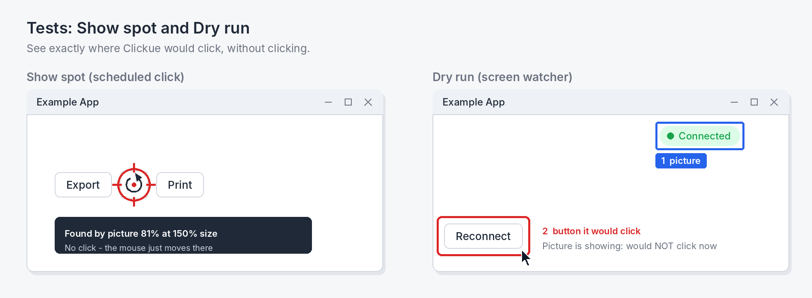

| Test | For | What it does |
|---|---|---|
| **Show spot** | All jobs | Moves the mouse to where it would click right now, shows a pulsing crosshair, and says how it found the spot. Optionally outlines every similar picture too ([section 4](#checking-a-spot)). **No click** |
| **Test click now** | All jobs | Clicks once right away, including the extra steps. The schedule isn't changed |
| **Schedule test click…** | All jobs | Clicks once in X minutes (at least 5 s away). Follows the same rules as a real click: waits for the screen, retries, then reports |
| **Check picture** | Watchers | Is the watched picture on screen (or in its area) right now? Marks it for the time set in Preferences → Clicking, outlines **every copy** it finds, and can outline similar pictures too |
| **Dry run** | Watchers | Marks the watched picture, then the button, and says whether it **would** click now. **No click** |
| **Schedule watcher test…** | Watchers | Runs the watcher check later, in the background. Optionally **really clicks** if the picture is missing |

- **Sections (4.5.4).** **All tests**, **Click tests** and **Watcher tests** at the top of the
  window. Each section shows only its own buttons and its own **history**, right under the
  buttons, and each remembers whether it lists **This job** or **All jobs**. So *Watcher tests*
  + *All jobs* lists every watcher check of every watcher, while *Click tests* + *This job*
  lists only the selected job's click tests.
- **Pending tests** show as **purple rows** in the job list with a countdown. Right-click them
  to **change the test time** or **cancel** them; **Cancel pending tests** in the Tests window
  cancels them all.
- **Test history** lists the section's results for **This job** or **All jobs**. Select a line
  to see all the details. **Clear** empties it (all sections). Type in the **🔍** box to
  filter it; right-click for copy and more ([section 15](#logs-copy-filter-and-show-on-screen)).
- **What the colours mean.** Each row's **Meaning** column says it in words, and a legend
  under the table repeats it:

  | Colour | Meaning | Example |
  |---|---|---|
  | Green | ✔ **OK**: as expected | *Picture found at (878, 243)*; a test click worked |
  | Orange | ⚠ **Attention**: worth a look | *Picture NOT on screen - the watcher would click*, a dry run that would click now |
  | Red | ✖ **Failed**: the test couldn't do its job | the screen stayed locked; the button wasn't found |

- **Double-click** a result with a place in it, like *(878, 243)*, to show that place on
  screen. The history scrolls sideways when the window is narrow.
- The same tests are on each job's **right-click menu**, and the editor has **Show spot**,
  **Check now** and **Dry run** buttons so you can test before saving.
- **Test click now** goes through the same one-at-a-time queue as everything else, ahead of
  other waiting jobs.

### Dry run and Step through for steps

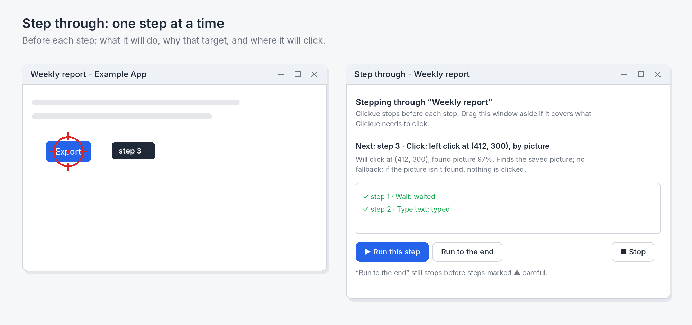

Two buttons at the bottom of the job editor (and **Dry run of its steps** on the right-click
menu) test a job's **steps**, using the job as it is in the editor, before you save:

| Test | What it does |
|---|---|
| **Dry run** | Goes through every step **without clicking or typing**. Finds each target on the screen as it is now, checks each condition, and lists what would happen: *would click at (412, 300) - found picture 97%*, *condition is false now → runs the Otherwise steps*, *would paste 24 characters*. Loops are shown once and waits aren't waited. Typed text is only counted, never shown |
| **Step through…** | Runs the job **for real**, but stops before every step. A small window shows the **next step**, **why** its target was chosen (*found picture 97%*, *the target is NOT there right now*, *the text goes to "Untitled - Notepad"*), and a marker on the screen where it will click. **▶ Run this step** does it; **Run to the end** carries on but still stops before steps marked **⚠ careful**; **■ Stop** ends the run. Results are listed as they happen |

Clickue's other windows hide during Step through. Drag the small window aside if it covers
what Clickue needs to click: Clickue never clicks through its own windows, so the step would
fail safely instead.

**Scenario: does it still work after I disconnect?** Schedule a test click 2 minutes ahead,
leave the remote session the way you normally would (see
[section 18](#18-locked-screens-remote-desktop-and-virtual-machines)), reconnect later and read
the result in the Test history or *Last result*. If it says *screen locked or session
disconnected*, the way you left the session stopped clicks from working.

---

## 11. Starting, pausing, stopping and taking turns

| Action | How | Effect |
|---|---|---|
| **Start** | ▶ Start, Space, or right-click | Turns the job on. Scheduled clicks get their first time (the *First scheduled time*, or one interval from now). Limits count from now |
| **Stop** | Same button | Turns the job off and clears its schedule |
| **Pause** this job | ⏸ Pause, **P**, or right-click | Keeps the schedule but doesn't click. A click that comes due while paused is **skipped**, not fired the moment you resume |
| **Pause all** | ⏸ Pause all, **Ctrl+P**, the tray menu, or **Ctrl+Alt+P** from anywhere | Pauses every job. A job in the middle of its steps **pauses before its next step** (letting go of any held keys) and carries on when you resume |
| **Stop this run** | The bar above the job list while a job runs | Ends the running job at the next safe point (between steps, or during a wait). The job stays on for its next time |
| **Emergency stop** | **Ctrl+Alt+X** from anywhere, ☰ Menu or the tray menu → **Stop everything now** | Ends the running job at once, drops everything waiting its turn, lets go of all held keys and mouse buttons, throws away a recording in progress, and **pauses all**. Resume all to continue |

Use **Pause all** before you sit down to work on the computer yourself, and resume when you
leave. The global hotkeys work even while Clickue is hidden.

### One mouse: jobs take turns

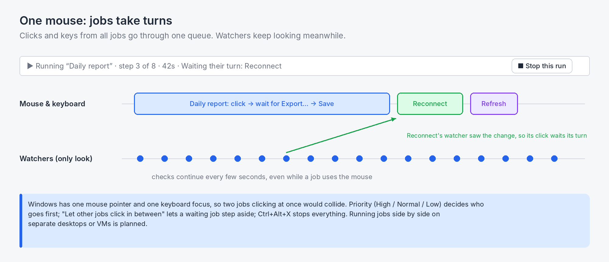

Windows has **one mouse pointer and one keyboard focus** per desktop. If two jobs clicked or
typed at the same time, they'd fight over them: one would move the pointer away from the
other's target, or type into the other's field. So Clickue sends all clicks and keystrokes
through **one queue**, one job at a time:

- **Watchers keep watching** while another job is running; looking at the screen doesn't need
  the mouse. When one sees its change, its click waits in the queue.
- The **bar above the job list** shows what's running (*Running "Daily report" · step 3 of 8 ·
  42s*) and who is **waiting their turn**. **■ Stop this run** ends the running one. The log
  also notes when a job waited more than 10 seconds for another.
- **Priority** (Edit → **Run options**): *High*, *Normal* or *Low* decides who goes first when
  several jobs are due at once. Test clicks you start yourself always go first.
- **Let other jobs click in between** (Run options): while this job's steps are only waiting (a
  *Wait* or *Wait for a picture*), a queued job from someone else may run, then this one
  continues. Only tick it if the other jobs can't disturb this one (different windows, nothing
  that changes focus); it's off by default.
- **Conflict warnings:** when you save a running job that uses the **same window**, or clicks
  the **same fixed spot**, as another running job, Clickue tells you. They still never click at
  the same moment, but one may change what the other expects to see. (Preferences → Clicking →
  *Warn me when two running jobs use the same window or spot*.)

**Several "mice" at once?** Not on one desktop: Clickue doesn't fake multiple pointers, because
Windows only has one and they'd collide. Running jobs side by side on **genuinely separate**
desktops (for example several virtual machines, each with its own screen) is **planned**; the
queue is built so such isolated "workers" can be added later. Until then, run a separate copy
of Clickue inside each machine.

---

## 12. Safety features

- **Emergency stop.** **Ctrl+Alt+X** ends the running job, drops queued clicks, lets go of
  held keys and buttons, and pauses everything.
- **Held keys and buttons are always released** when a run ends for any reason, and when
  Clickue exits.
- **Waits until you're idle.** Clickue won't move the mouse until the mouse and keyboard have
  been idle for 5 seconds (change it, or turn it off with 0, in **Preferences → Clicking**). It
  doesn't grab the mouse from under you.
- **Puts the mouse back** where it was after each click (optional).
- **Won't click a covered target.** If another window, or Clickue itself, is on top of the spot,
  it waits and retries instead.
- **Detects a locked or disconnected screen** and waits instead of clicking blindly
  ([section 18](#18-locked-screens-remote-desktop-and-virtual-machines)).
- **Checks before every click** (when finding by picture or window). If the target isn't
  there, nothing is clicked, and it never silently switches to an unchecked position.
- **Limits on everything that waits or repeats:** each *Wait for a picture* (up to 1 hour),
  each *Repeat* (times and seconds), each run (**Stop a run that takes longer than**, default
  6 h), and at most 200,000 steps per run.
- **One job at a time** through one queue, so jobs never click over each other
  ([section 11](#11-starting-pausing-stopping-and-taking-turns)).
- **One copy at a time**, so jobs never run twice.
- **Test before you trust:** Show spot, Dry run and Step through
  ([section 10](#10-testing-a-job)); mark consequential steps **⚠ careful**.
- **Imported jobs arrive stopped** and are checked first ([section 14](#14-managing-jobs)).
- **Keeps the PC and display awake** while it runs (optional), so sleep doesn't stop the jobs.
- **Limits and active hours** stop jobs from running longer or more often than you meant.

> [!CAUTION]
> Automated clicking can do real things in real apps: submit forms, send messages, place
> orders. Test with **Dry run** and **Step through** first, prefer **Find the spot by its
> picture**, mark consequential steps **⚠ careful**, and read
> [Security, privacy and responsible use](#24-security-privacy-and-responsible-use). Many
> websites and services don't allow automation; check their terms.

---

## 13. Notifications and phone alerts

### Tray notifications

With **Tray notifications** on (**Preferences → General**), Windows shows a notification for
watcher clicks, missed or failed clicks, and test results.

### Phone alerts

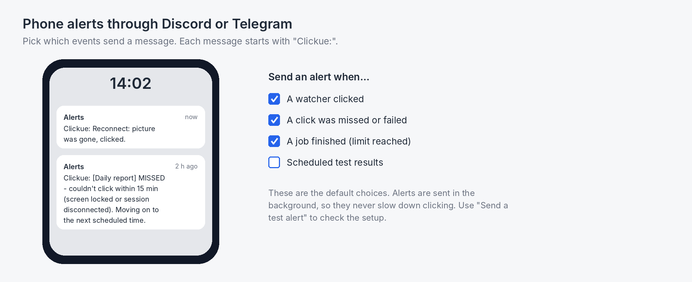

**Preferences → Phone alerts**, tick **Send alerts to my phone**, and set up one or both
services:

**Discord**
1. In a Discord server you own (create a private one just for alerts), open the channel's
   **Edit channel → Integrations → Webhooks → New webhook**.
2. **Copy webhook URL** and paste it into **Discord webhook URL**.
3. Install the Discord app on your phone and turn on notifications for that channel.

**Telegram**
1. In Telegram, message **@BotFather**, send `/newbot` and follow the steps. Copy the **token**
   into **Telegram bot token**.
2. Send your new bot any message (so it's allowed to message you).
3. Get your **chat id**, for example by messaging **@userinfobot**, and paste it into
   **Telegram chat id**.

**Choose the events** under **Send an alert when…**:

| Event | Example message | Default |
|---|---|---|
| A watcher clicked | `Clickue: Reconnect: picture was gone, clicked.` | On |
| (also) | `Clickue: Emergency stop: everything is paused.` and *screen video stopped* messages use the "missed or failed" choice | |
| A click was missed or failed | `Clickue: [Daily report] MISSED - couldn't click within 15 min (…)` | On |
| A job finished (limit reached) | `Clickue: Weekly export finished: …` | On |
| Scheduled test results | `Clickue: Reconnect watcher test: …` | Off |

Click **Send a test alert** to check. The result shows next to the button (✔ sent, or the
error). Alerts are sent in the background, so a slow connection never delays clicking. They
need internet access from the computer running Clickue. **Save** checks that the webhook URL
really is a Discord webhook and that the token and chat id look right.

**How alerts are protected**

- Alerts only go to **discord.com** webhooks and **api.telegram.org**, always over **HTTPS**
  with certificate checks. Other addresses are refused when you save, and redirects to anywhere
  else aren't followed. There's no way to make Clickue post to any other address.
- Each try gives up after 10 seconds and in the background, so a slow or failing connection
  never delays clicking.
- At most one alert every 2 seconds and 60 an hour per service, so a flapping watcher can't
  flood your phone. **Send a test alert** isn't limited.
- The webhook URL and bot token are **masked** in Preferences, removed from the log and error
  messages, and **not copied into backups or exported jobs**.
- **Protect them with my Windows account** (Preferences → Phone alerts) encrypts them in
  `settings.json`. They can then only be read by your Windows account on this computer; after
  moving to another PC, enter them again (Clickue tells you).

> [!WARNING]
> Anyone with your webhook URL or bot token can post to that channel or bot. Keep them private,
> and remove them from screenshots you share.

---

## 14. Managing jobs

- **New:** ＋ New click (Ctrl+N) or 👁 New watcher (Ctrl+Shift+N).
- **Edit:** double-click, Enter, Edit, or right-click → Edit…. The editor warns you if you try
  to close it with unsaved changes. It remembers its size and can be resized; long editors
  scroll.
- **Duplicate:** a copy of the selected job, a quick way to make a similar one.
- **Delete:** Del, Delete, or right-click. A bar with **↶ Undo** appears; Ctrl+Z (or
  ☰ Menu → Undo delete) brings it back.
- **Right-click** any job for every action: Edit, Start/Stop, Pause/Resume, the tests, Stats &
  click history, Run history, Dry run of its steps, Tick, Duplicate and Delete.

### Ticking jobs: batch actions

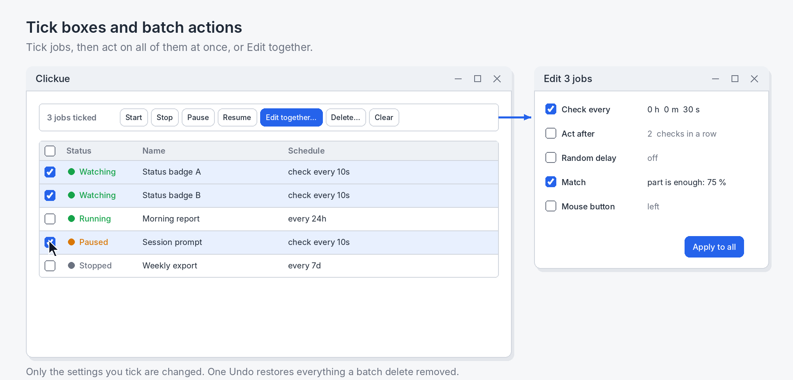

Every row of the job list starts with a **tick box**. Tick the jobs you want to work on
together:

- **Click the box** at the start of a row (or select the row and press **X**). Click again to
  untick.
- **The box in the heading** ticks every job shown (with the current filter), or unticks them
  all. **Ctrl+A** in the list ticks every job shown.
- Ticked rows are tinted, and a **bar** appears above the list: *3 jobs ticked*, then
  **▶ Start**, **■ Stop**, **⏸ Pause**, **▶ Resume**, **✎ Edit together…**, **⧉ Duplicate**,
  **🗑 Delete…**, **Tick all** and **Clear**. On a narrow window the bar wraps onto a second
  line instead of hiding anything.
- Ticks are just a selection: they aren't saved and don't change any job until you use one of
  the buttons. The normal toolbar still works on the highlighted row.

| Batch action | Effect on each ticked job |
|---|---|
| **Start / Stop** | Like ▶ Start / ■ Stop. Jobs that are already running (or stopped) are skipped and the Activity log says how many |
| **Pause / Resume** | Like ⏸ Pause / ▶ Resume for running jobs; stopped jobs are skipped |
| **Duplicate** | Makes a stopped copy of each, and ticks the copies, ready for *Edit together* |
| **Delete…** | Asks once (listing the names), then deletes them all. **One Undo** (the bar, Ctrl+Z or ☰ Menu) brings every one of them back in its place, running again if it was |
| **Edit together…** | Sets the same settings on all of them (below) |

#### Edit together

**✎ Edit together…** opens one editor for all ticked jobs. Each setting has a tick box in
front of it; **only the settings you tick are changed**, everything else stays as it is in
each job. The values shown at first are those of the first ticked job.

| Group | Settings |
|---|---|
| **Every ticked job** | Mouse button, single/double click, priority, click-spot picture (exact only or similar counts), if the picture isn't found, active hours (times, days, outside them), stop a run after, bring its window to the front, let other jobs run, screen video, failure screenshot |
| **Scheduled clicks only** | Scheduled every, random delay (on/off, from, up to) |
| **Screen watchers only** | Check every, act after N checks in a row, random delay before clicking, wait after each click, click only once, match (exact or part of the picture) |

Settings that don't fit a kind of job are left alone for it (a watcher's *Check every* isn't
applied to a scheduled click). Values are checked like an import. A running job picks up new
timing right away (a scheduled click gets its next time from now; a watcher starts watching
afresh), and a paused job stays paused. If a job's random delay *from* ends up above its *up
to*, the other one is moved to match. Click **Apply to all**; Clickue says how many jobs
changed, and the Activity log lists what was changed.

**Scenario.** Ten watchers check every 10 seconds and you want them to check every 30 seconds
during the day: tick them (filter *Screen watchers*, then the heading box), **Edit together…**,
tick **Check every**, set 30 s, **Apply to all**.

### Import and export

**↑ Export** saves all your jobs, and the step groups they use, to a `.json` file. Secret text
is **left out** (those steps will ask for it again), and your alert settings are never in it.
The saved pictures of your spots are in it, so treat it like a screenshot.

**↓ Import** reads a jobs file. Clickue treats it as **untrusted** until you've checked it:

- Files over 50 MB, files that aren't Clickue jobs, and files from a newer Clickue are refused
  with a reason.
- Every job and step is **checked and cleaned**: unknown fields are dropped, numbers are kept
  to sensible ranges, pictures that are damaged or huge are left out, and unknown or invalid
  steps are left out. Nothing in a jobs file is ever run as code.
- Clickue tells you how many steps **type, paste, press or hold keys**, and how many problems
  were fixed.
- Then it asks: **Yes** = add them to your current jobs, **No** = replace your current jobs
  (a backup is saved first), **Cancel** = do nothing.
- Imported jobs arrive **stopped**. Check each one (**Edit**, **Dry run**) and start it yourself.

**Scenario: move to a new computer.** Export on the old one, copy the file, Import on the new
one, then **Dry run** each job. Picture-based spots usually work straight away; re-pick any
that don't, and enter secret texts again.

---

## 15. History, run history, stats and logs

### Click history

Every click, miss and failure is recorded with the time, the job, the type (scheduled, watcher,
test, manual), the result, the position and how the spot was found. The history keeps up to
50,000 rows (the oldest are dropped). Turn it off in **Preferences → Data & backups**.

- **☰ Menu → Export click history (CSV)…** saves all of it. It opens in Excel, LibreOffice or
  Google Sheets.

### Stats per job

Right-click a job → **Stats & click history…**:

- **Clicks total**, **Today**, **Last 7 days** and **Problems**,
- the **last click** and **last problem**, clicks **by type**,
- **Recent activity** (the last 200 entries),
- **Export this job's history…** to a CSV of just that job.

### Run history

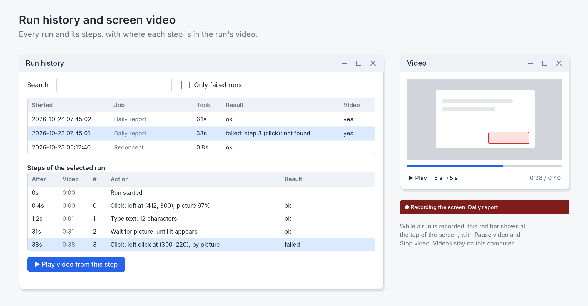

**☰ Menu → Run history & videos…** (or right-click a job → **Run history…**) lists every run:
when it started, the job, how long it took, the result, and whether it has a video. Select a
run to see **each step**, how long after the start it happened, its **position in the video**,
and its result.

- **Search** finds runs by job name, step or result; **Only failed runs** narrows it down.
- **▶ Play video from this step** opens the run's video at that step (if the run was recorded,
  [section 16](#16-screen-video-of-runs)).
- The run history never contains the text of Type or Paste steps, only how many characters.
- It's one compact file (`run_history.csv`) that keeps the newest 50,000 lines. Turn it off in
  **Preferences → Recording & video**.

### Activity and the log file

The **Activity** panel shows what's happening, colour-coded, filterable to **Clicks** or
**Problems** and with a **🔍 filter** box. Since 4.5.5 it **keeps its lines when you exit
and start Clickue again** (the last 800 lines are read back from the log file). They're only
removed by **Clear view** (they don't come back after that), or at every start if you turn on
**Preferences → General → Clear Activity every time Clickue starts**. Everything also goes into the log file (**☰ Menu → Open log file**). The log
is limited to 1 MB by default (**Preferences → Data & backups**); two older copies are kept
and older ones are deleted, so it never grows without limit. Phone-alert credentials are
removed from every log line, and typed or pasted text never appears in it.

### Logs: copy, filter and show on screen

Every log in Clickue (Activity, the Tests window's history, Run history and its steps, a
job's Stats, and Dry run results) works the same way (4.5.5):

| Do | What happens |
|---|---|
| **Right-click** a row (or a line in Activity) | **Copy** (the selected rows), **Copy "column" only** (just that cell), **Copy everything shown** (with the headings), **Select all**, **📍 Show this place on screen** (when the row mentions a place), **Filter to this job / test**, **Edit this job…**, **Save what's shown as CSV…** (Activity: as a text file), Clear the filter |
| **Ctrl+C** / **Ctrl+A** | Copy the selected rows / select every row shown |
| **Ctrl+F**, or type in the **🔍** box | Show only rows that contain that text (any column, case doesn't matter); **Esc** or **✕** clears it |
| **Click a place** in Activity, or **double-click** a test or stats row with a place | **Show it on screen** (see below) |

Copied rows are tab-separated with the columns in order, so they paste straight into a
spreadsheet. Wide logs get a **horizontal scrollbar** as soon as their text is wider than the
window, so long results can always be read in full.

**Show on screen.** Clickue hides, like for **Check picture**, and marks every place the line
mentions: the crosshair on the spot, and where the line says a watched picture was found, the
picture's outline at its size (and display scaling). The marks stay for the time set in
**Preferences → Clicking** (click or press Esc to close them early), then Clickue comes
back. It shows where something **was** found when the line was written; to look again now,
use **Check picture** or **Show spot**.

---

## 16. Screen video of runs

Clickue can record the screen **while a job runs**, so you can see afterwards exactly what
happened. It's **off** until you turn it on, and then only for the jobs you choose.

1. **Preferences → Recording & video** → tick **Allow screen videos for jobs that ask for it**.
2. Edit a job → **Run options** → tick **Record the screen while it runs**.

While a run is being recorded, a small **red bar** at the top of the screen says so, with
**Pause video** and **Stop video** buttons. The video starts when the run starts and stops when
it ends; nothing is recorded in between runs. Stopping the video never stops the job.

| Quality | Frames | Size on screen | Very rough size per hour |
|---|---|---|---|
| **Compact** | 2 a second | Half | 10–40 MB |
| **Standard** (default) | 5 a second | ¾ | 40–150 MB |
| **High** | 10 a second | Full | 150–600 MB |

Busier screens make bigger files. Videos are **MP4** (or **AVI** if MP4 isn't available on the
computer), playable in Windows' own video player, and in Clickue's run history.

**Privacy and safety**

- **Local only.** Videos are saved in `%APPDATA%\Clickue\recordings` (or a folder you choose)
  and never uploaded or sent anywhere.
- **Hidden areas.** **Add an area to hide…** draws a box that's always **blacked out** in
  videos and failure screenshots, e.g. a chat window or a panel with personal data.
- **Black out while text is entered** (on by default): the video shows a dark frame while
  Clickue types or pastes, and for a second after.
- **Clean-up:** videos older than **14 days** are deleted, and the oldest go first when they
  take more than **5 GB** (both adjustable). Only Clickue's own video files are ever deleted,
  even in a folder you chose.
- **Disk space:** a video doesn't start with less than 1 GB free, and stops if free space drops
  below 300 MB. If anything goes wrong with the video (disk full, no video format available,
  the screen can't be captured), the **video stops and the job carries on**; the log and an
  alert say why.

**Failure screenshots.** Edit → Run options → **Save a screenshot on this computer if its steps
fail** saves one picture of the screen when a run fails, in `diagnostics\` (hidden areas
blacked out; skipped if text was just being entered). The newest 30 are kept.

---

## 17. Backups and your data

### Where your data lives

Everything is in **`%APPDATA%\Clickue`** (or `ClickueData` next to `Clickue.exe` in portable
mode). Open it with **☰ Menu → Open data folder**.

| File | Holds |
|---|---|
| `jobs.json` | Your jobs and step groups |
| `settings.json` | Your preferences |
| `click_history.csv` | The click history |
| `run_history.csv` | The run history ([section 15](#run-history)) |
| `test_history.json` | Test results |
| `clickue.log` (+ older copies) | The log |
| `backups\` | Backups |
| `recordings\` | Screen videos, if you use them and didn't choose another folder |
| `diagnostics\` | Failure screenshots, if you turned them on |

Your data **survives** reinstalling, updating and moving the program. If a file is ever
damaged, it's set aside (renamed to `.corrupt`) instead of wiping your jobs, and Clickue
offers to restore the newest backup.

> [!IMPORTANT]
> **The installed version and a portable copy keep separate jobs.** The installed Clickue uses
> `%APPDATA%\Clickue`; a portable copy uses the `ClickueData` folder next to its
> `Clickue.exe`; running from source uses `%APPDATA%\Clickue` unless a `portable.txt` sits
> next to `clickue.py`. If your jobs seem to have "gone back" after switching between them,
> they're in the other folder: the status bar and the first Activity lines show which folder
> is in use. Move jobs between them with **Export jobs…** / **Import jobs…**, or restore a
> backup.

If saving ever fails (for example another program holds the file), Clickue tries again,
writes the reason in the Activity log and shows a warning once, instead of failing silently.

### Backups

- **Automatic:** once a day, of all jobs and settings. The newest 14 are kept (adjustable).
- Backups contain your jobs, step groups and settings, but **never your phone-alert
  credentials**.
- **Before an upgrade:** the first time a new version starts with your jobs, it saves a backup
  named *before-upgrade-&lt;version&gt;* (for example *before-upgrade-4.5.5*) before saving
  anything. Older jobs keep working exactly as before.
- **☰ Menu → Backups…** lists them (Daily, Manual, Before a restore, Before an import, Before a
  fresh start, Before an upgrade) with how many jobs each holds.
  - **Back up now** makes a manual backup.
  - **Restore…** (or double-click) asks **Yes = replace** your current jobs, **No = add**
    them. Your current jobs are backed up first, and restoring never deletes backups.
  - **Open folder** opens the backups folder.

### Updating and uninstalling

See [section 25](#25-install-portable-and-uninstall): what is kept when you update, and exactly
what is removed or kept when you uninstall.

---

## 18. Locked screens, remote desktop and virtual machines

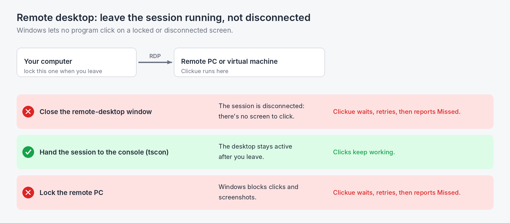

Windows doesn't let **any** program click on, or take pictures of, a **locked** screen or a
**disconnected** remote-desktop session. It's a Windows security rule, not a Clickue
limitation. While that's the case, Clickue waits, retries, and then reports *Missed*. It never
clicks blindly.

**To keep Clickue working while you're away:**

- **Don't lock the computer running Clickue.** Turn off its screensaver lock and automatic
  lock, and lock the computer you connect **from** instead.
- **Leaving a remote-desktop (RDP) session:** instead of closing the window, hand the session
  to the console so the desktop stays active. Run this from an **administrator** command
  prompt inside the session (it disconnects you, which is expected):

  ```bat
  for /f "skip=1 tokens=3" %s in ('query user %USERNAME%') do %windir%\System32\tscon.exe %s /dest:console
  ```

  To use it in a `.bat` file, double the percent signs (`%%s`). Next time, connect again as
  usual.
- **Virtual machines:** the VM's own console (in the hypervisor) counts as a real screen.
  Protect the hypervisor and any remote access with strong passwords and two-factor sign-in,
  because the session itself stays unlocked.
- **Check it works:** **Schedule test click…** 2 minutes ahead, leave the session, come back,
  and read the result.

**Different screens, same job.** Connecting from different devices often changes the
resolution and scaling. **Find the spot by its picture** handles this; fixed positions don't.

**One desktop, one mouse.** Each Windows desktop (each VM, each signed-in session shown on
screen) has one mouse and keyboard focus, so Clickue runs one job at a time there. To run
automations side by side, run a copy of Clickue inside each machine.

---

## 19. Window, tray, hotkeys and appearance

### System tray

- **Minimize to the system tray** and **Close button (X) hides to the tray** are on by default,
  so jobs keep running after you close the window. The first time, a notification reminds you
  that Clickue is still running.
- **Tray menu** (right-click the icon): **Show window**, **Job status**, **Pause all / Resume
  all**, **Stop everything now**, **Exit**.
- To quit completely, use **Exit** in the tray menu or ☰ Menu.

### Job status at a glance (tray icon)

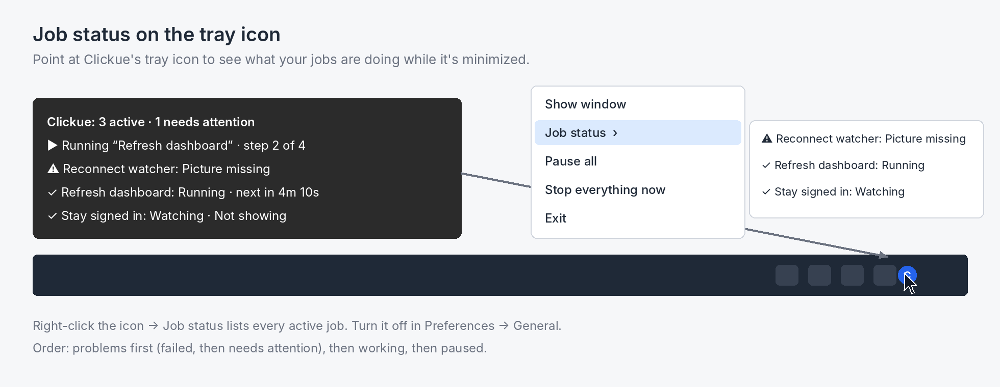

While Clickue is minimized, **point at its tray icon** to see whether your jobs are healthy:

- The first line sums it up: *Clickue: 3 active · all OK*, *… · 1 needs attention*, *Clickue:
  ALL PAUSED*, or *Clickue: no jobs running*.
- If a job is running right now: *▶ Running "Refresh dashboard" · step 2 of 4*.
- Then one line per active job, **problems first**: ✖ failed (for example *Missed* or *Click
  FAILED*), ⚠ needs attention (a watcher seeing a change, a job waiting because the screen is
  locked), ✓ working normally (*Running · next in 4m 10s*, *Watching · Seen 13:49:58*), ⏸ paused.
- Windows shows at most about 127 characters there, so with many jobs the tooltip ends with
  *+N more*. **Right-click the icon → Job status** lists **every** active job in full, with
  clock times (*next at 19:16:30*); clicking one opens the window.

The tooltip's countdowns are **live**: they count down second by second while you point at
the icon. Turn it off in **Preferences → General → Show the
jobs' status when I point at the tray icon**; the tooltip then just says *Clickue*.

> [!NOTE]
> Windows may remember an icon's old name in **Settings → Personalization → Taskbar → Other
> system tray icons** for a program it has seen before (for example if an older version ran
> from the same place). Clickue 4.5.1 tells Windows its name and identity explicitly (also in
> the program file's details), so the tooltip and the Windows settings show **Clickue**.

### Global hotkeys

They work from any app, even while Clickue is hidden:

| Hotkey | Does |
|---|---|
| **Ctrl+Alt+P** | Pause / resume everything |
| **Ctrl+Alt+K** | Show / hide Clickue |
| **Ctrl+Alt+X** | Emergency stop: end the running job, drop queued clicks, let go of held keys, pause all |
| **Ctrl+Alt+R** | Start / stop recording a macro |
| **Ctrl+Alt+U** | Pause / resume the recording |

Change them in **Preferences → Hotkeys** (at least one of Ctrl, Alt, Shift or Win, plus a key).
Each hotkey must be different. Leave a box empty to turn that hotkey off. If another program already uses a combination,
the log says so; pick another.

### Starting with Windows

**Preferences → General:** **Start automatically when I sign in to Windows**, and **Start
minimized** to go straight to the tray.

### Appearance and layout

- **Light, dark or system** theme (follows Windows), including dark title bars. Switch it
  quickly with the theme button in the header.
- **Responsive:** toolbar buttons that don't fit go into **More ▾**, less important columns
  hide, and the summary cards re-flow from 4 to 2 to 1 per row. **▴ Summary** hides the cards.
- **Drag dividers** to resize the job list and Activity, and the parts of the Tests window.
- **Every window remembers its size and position** (and whether it was maximized). When
  Clickue hides itself for a pick, a test, Show spot or Check now, every window comes back
  **exactly** as it was, with the window you were using (for example the job editor) on top.
  Sizes and positions are only changed if a window wouldn't fit on the screen any more (for
  example a smaller remote-desktop screen).
- **Job list columns** can be dragged or fitted to their contents with a double-click on the
  column border, and are remembered ([section 3](#column-widths)).
- **Popups close when you click outside them** (they also have a Close button), so they never
  block the app.

---

## 20. Preferences, setting by setting

**☰ Menu → Preferences** (Ctrl+,). Click **Save** to apply.

### General

| Setting | Default |
|---|---|
| Minimize to the system tray | On |
| Close button (X) hides to the tray instead of exiting | On |
| Tray notifications (missed clicks, watchers, test results) | On |
| Start minimized | Off |
| Start automatically when I sign in to Windows | Off |
| Keep the PC and display awake | On |
| Show the jobs' status when I point at the tray icon (and in its menu → Job status) | On |
| Clear Activity every time Clickue starts (off: it keeps earlier lines until Clear view) | Off |

### Clicking

| Setting | Default |
|---|---|
| If a click can't happen (screen locked / disconnected), keep retrying for | 15 min |
| Wait until mouse & keyboard have been idle for (0 = off) | 5 s |
| Put the mouse back where it was after clicking | On |
| Warn me when two running jobs use the same window or spot | On |
| **Checking a spot:** keep the marker on screen for (Show spot, Check now) | 5 s (1 to 120) |
| Also point out every similar picture on the screen at the same time | Off |

### Watchers

| Setting | Default |
|---|---|
| New watchers check every | 30 s |
| New watchers click after the change is seen … checks in a row | 2 |

These are only starting values for **new** watchers; each watcher has its own settings.

### Hotkeys

| Setting | Default |
|---|---|
| Use global hotkeys | On |
| Pause / resume all | Ctrl+Alt+P |
| Show / hide Clickue | Ctrl+Alt+K |
| Emergency stop | Ctrl+Alt+X |
| Start / stop recording | Ctrl+Alt+R |
| Pause / resume recording | Ctrl+Alt+U |

### Phone alerts

| Setting | Default |
|---|---|
| Send alerts to my phone | Off |
| Discord webhook URL / Telegram bot token / Telegram chat id (masked) | Empty |
| Protect them with my Windows account | Off |
| Send an alert when… | Watcher clicked, missed or failed, job finished: on. Test results: off |

### Recording & video

| Setting | Default |
|---|---|
| Record mouse movement (simplified) | On |
| Save a picture of each clicked spot | On |
| Keep the pauses between actions | On |
| Allow screen videos for jobs that ask for it | **Off** |
| Quality | Standard |
| Save videos in | `recordings` in the data folder |
| Delete videos older than … days | 14 |
| … and keep at most … GB | 5 |
| Black out the video while Clickue types or pastes text | On |
| Always hidden in videos and failure screenshots | No areas |
| Keep a run history | On |
| Keep the newest … failure screenshots | 30 |

### Appearance

| Setting | Default |
|---|---|
| Theme | System |
| Show the summary cards at the top | On |

### Data & backups

| Setting | Default |
|---|---|
| Back up my jobs and settings once a day | On |
| Keep the newest … daily backups | 14 |
| Keep a click history (for stats and CSV export) | On |
| Log file size limit | 1 MB |

Plus buttons for **Backups…**, **Open data folder**, **Export click history…** and
**Uninstall Clickue…**.

---

## 21. Recipes: complete examples

### Recipe 1: refresh a page every 15 minutes during the day

| | |
|---|---|
| Kind | Scheduled click |
| Where | The page's *Refresh* button (or the browser's reload button), picture on, Medium |
| Schedule | Every 0 h 15 min, random delay 5 s to 2 min, fixed schedule on |
| When it may run | 07:00 to 19:00, Mon–Fri, outside hours: skip |
| Test | Show spot, then Test click now |

### Recipe 2: reconnect when the connection drops

| | |
|---|---|
| Kind | Screen watcher, **when the picture disappears** |
| Picture | The *Connected* badge |
| Button | *Reconnect* |
| Timing | Check every 20 s, 2 checks, random delay 1–5 s, after-click wait 60 s, click only once on |
| Alerts | A watcher clicked: on |
| Test | Check now, then Dry run. Then Schedule watcher test… with "really click" off |

### Recipe 3: refresh, export and save a report

| | |
|---|---|
| Kind | Scheduled click, every 24 h, first scheduled time 07:30 |
| Main click | *Refresh* |
| Step 1 | Wait for a picture: *Export* appears, then click it, up to 60 s, stop the chain |
| Step 2 | Wait for a picture: *Save* appears, then click it, up to 30 s, stop the chain |
| Step 3 | Wait for a picture: "Download complete" appears, up to 120 s |
| Test | Test click now while watching; check Activity for each step |

### Recipe 4: press "Stay signed in" whenever it pops up

| | |
|---|---|
| Kind | Screen watcher, **when the picture appears** |
| Picture | The *Stay signed in* button (open the prompt once to draw it) |
| Click | **Click the picture itself** |
| Timing | Check every 15 s, 1 check, random delay 1–3 s, click only once on |

### Recipe 5: recover from an error in several steps

| | |
|---|---|
| Kind | Screen watcher, **when the picture appears** |
| Picture | The error banner; click the picture itself is off, button: *Retry* |
| Step 1 | Wait for a picture: *Sign in* appears, then click it, up to 60 s, **continue anyway** (sometimes you're still signed in) |
| Step 2 | Wait for a picture: the main page's header appears, up to 120 s |
| Limits | Stop after 5 clicks, so a permanent problem doesn't loop forever; alert on finish |

### Recipe 6: a weekly task with a deadline

| | |
|---|---|
| Kind | Scheduled click, every 7 days, first scheduled time 09:00, random delay off |
| Steps | Click the *New* button → Type the text → Press `Ctrl+S` |
| When it may run | Stop at the last day of the project, e.g. `2026-12-18 18:00` |

### Recipe 7: a recorded routine, made reliable

| | |
|---|---|
| Kind | **⏺ Record** → a steps-only job |
| Clean-up | Remove mouse movements and short waits; **Picture of this spot now** on any click without a picture; turn waits for screens into **Wait for a picture** |
| Safety | Mark the final *Submit* ⚠ careful; **Step through** once |
| Run | Scheduled every day at 09:00, active hours Mon–Fri |

### Recipe 8: only sign in when needed

| | |
|---|---|
| Kind | Any job with steps |
| Steps | **If a picture is showing** (the *Sign in* button, wait up to 5 s) → **Click a spot** *Sign in* → **Wait for a picture** the main page → **End** → the rest of the routine |

### Recipe 9: keep pressing "Load more" until everything is shown

| | |
|---|---|
| Kind | Steps-only job, run with **Test click now** when needed |
| Steps | **Repeat until a picture is showing** ("No more results"), at most 30 times / 300 s → **Wait for a picture** *Load more* appears, then click it, up to 20 s → **Wait** 1 s → **End** |

### Recipe 10: a dated file name

| | |
|---|---|
| Steps | … **Wait for a picture** the Save dialog → **Paste text** `Report {date} {hour}{minute}.xlsx` with **Fill in {variables}** → **Press keys** Enter |
| Tip | A counter instead: **Set a variable** `n` *add* 1 (**Remember it for the next run**), then paste `Batch {n}` |

---

## 22. Industries and workflows

Practical, step-by-step examples by field. Each uses only features that exist today. They're
starting points: your apps will look different, so draw your own pictures and test with
**Dry run** and **Step through**.

> [!IMPORTANT]
> Follow your workplace's policies and the terms of the programs and sites you automate.
> Anything sensitive or consequential (patient, customer or financial data; orders; messages;
> production equipment) needs careful testing, a person who checks the results, and limits.
> Clickue is not certified for regulated use and doesn't guarantee correctness or safety.

### QA and software testing: replay a smoke test on each build

1. Install the new build, open it at its start screen.
2. **Record** the smoke test once: open a project, run the main action, open the result.
3. Replace guessed waits with **Wait for a picture** of each screen (the project list, the
   "Done" message, the result view).
4. Finish with **Wait for a picture** of the expected result (up to 30 s, *stop the chain*), so
   a broken build makes the run fail and shows up in the run history and alerts.
5. Turn on **Record the screen while it runs** and **Save a screenshot if its steps fail**, so
   each run's video and the run history show where it went wrong.
6. Run it with **Test click now** (Tests) after each build, or schedule it nightly.

### IT operations and remote support: keep a console connected

1. **New watcher → when the picture disappears**: the console's *Connected* badge. **Search
   only an area** around the status bar.
2. Button: *Reconnect*. Steps: **Wait for a picture** of the sign-in prompt (up to 60 s,
   continue anyway) → **If a picture is showing** (the prompt) → click *Sign in* → **End**.
3. Phone alerts: *A watcher clicked* and *A click was missed or failed*.
4. Limits: **Stop after 10 clicks**, so a permanent outage doesn't loop all night.

### Office and administrative work: the morning export

1. **New click**, every 24 h, first scheduled time 07:45, active hours Mon–Fri.
2. Main click: *Reports*. Steps: **Wait for a picture** *Export* appears, click it → **Wait for
   a picture** the Save dialog → **Paste text** `Daily report {date}.xlsx` (Fill in variables)
   → **Press keys** Enter → **Wait for a picture** "Saved".
3. Mark the Enter step **⚠ careful** while you're testing, and **Step through** it once.

### Manufacturing and laboratory workflows: acknowledge "ready" prompts

1. **New watcher → when the picture appears**: the vendor app's *Sample ready* banner.
2. **Click a button when this happens** off; steps: **Click a spot** *Acknowledge* (by its
   picture) → **Wait for a picture** the banner goes away (up to 30 s).
3. **Active hours** for the shift only; **phone alerts** for failures.
4. Turn on the **run history** (on by default) and, if your site allows it, **screen video**,
   so each acknowledgement can be reviewed later.
5. Never let Clickue confirm anything that changes equipment settings or results without a
   person checking it.

### Customer support and staff training: show the routine

1. **Record** a routine task once (e.g. opening a case, filling in the standard fields).
2. Give each step a **Name** ("Open the case", "Set the category"), and mark the step that
   sends anything **⚠ careful**.
3. Use **Step through…** with a new colleague: before each step it shows what will happen and
   why that target was chosen. **■ Stop** at any point.
4. Keep the steps that are the same every time in a **step group**, e.g. *Close the case
   view*, and reuse it in several jobs.

### Accessibility and reducing repetitive strain

1. **Record** the long click sequence you repeat many times a day.
2. Clean it up (remove mouse movements and short waits), check it with **Dry run**.
3. Assign it a quick way to run: open it from **Tests → Test click now**, or give it a
   schedule during the hours you need it.
4. Use **Paste text** for standard replies (one step instead of many keystrokes).

### Kiosks, dashboards and shared displays

1. **New click** every 5 minutes: the dashboard's *Refresh* button, by picture, random delay
   off.
2. **New watcher → when the picture appears**: the "Session expired" dialog → **Click the
   picture itself** (the *Stay signed in* button).
3. A second watcher **when the picture disappears**: the dashboard's header, with **Click a
   button when this happens** off → steps: **Press keys** F5 → **Wait for a picture** the header
   appears (up to 2 min).
4. Turn on **Keep the PC and display awake** (Preferences → General).

### E-commerce and content operations: work through a review queue

Only in admin tools where your organisation allows automation:

1. A steps-only job: **Repeat until a picture is showing** ("No more items"), at most 50 times
   and 30 minutes.
2. Inside the loop: **Click a spot** the first row → **Wait for a picture** the detail view →
   **Click a spot** *Approve* (⚠ careful) → **Wait for a picture** the confirmation → **Set a
   variable** `count` add 1 → **End**.
3. **Dry run**, then **Step through** the first two items, then run it while watching.
4. Never use Clickue for buying, bidding, ticketing or anything a site's terms forbid, and
   never to get around CAPTCHAs or rate limits.

---

## 23. Keyboard shortcuts

### In Clickue

| Keys | Does |
|---|---|
| Ctrl+N | New scheduled click |
| Ctrl+Shift+N | New screen watcher |
| Enter / double-click | Edit the selected job |
| Space | Start / stop the selected job |
| P | Pause / resume the selected job |
| Ctrl+P | Pause / resume all |
| Ctrl+T | Tests |
| Ctrl+Z | Undo delete (a batch delete comes back all at once) |
| X | Tick / untick the selected job (for batch actions) |
| Ctrl+Up / Ctrl+Down | More room for Activity / for the job list |
| Ctrl+C / Ctrl+A / Ctrl+F (in a log) | Copy the selected rows / select all / filter |
| Click the empty part of the job list | Unselect |
| Mouse wheel, + / −, 0, arrows, middle-drag | Zoom and move while drawing a box ([section 6](#zooming-in-while-you-draw)) |
| Ctrl+A (in the job list) | Tick every job shown |
| Ctrl+, | Preferences |
| Del | Delete the selected job (or the selected steps, in the timeline) |
| Esc | Cancel **Pick on screen** (from anywhere), or close a Show spot / Check now marker |
| Esc / right-click | Cancel drawing a box |
| Double-click a column border | Fit the column to its contents |

### Anywhere (global, changeable)

| Keys | Does |
|---|---|
| Ctrl+Alt+P | Pause / resume all |
| Ctrl+Alt+K | Show / hide Clickue |
| Ctrl+Alt+X | Emergency stop |
| Ctrl+Alt+R | Start / stop recording a macro |
| Ctrl+Alt+U | Pause / resume the recording |

---

## 24. Security, privacy and responsible use

> [!IMPORTANT]
> **Clickue is vibe-coded and was developed with substantial AI assistance.** Caution was taken
> during development, but AI-assisted development does not guarantee bug-free or secure
> software. Review the source and use normal precautions. Test automations safely, protect
> notification credentials, and avoid unattended use for consequential actions.

Clickue has had a security review of its own code (alerts, secrets, imports, files, uninstall,
input safety and the build), and its automatic build runs tests, a dependency vulnerability
check and a static code check. That is **not** a professional audit or a certification, and it
can't prove there are no problems. What was reviewed and how to report a problem:
[SECURITY.md](../SECURITY.md).

**What Clickue does to protect you**

- No telemetry, accounts or ads; no network use except the phone alerts you set up, and those
  only to Discord / Telegram over HTTPS ([section 13](#13-notifications-and-phone-alerts)).
- Alert credentials and secret text are kept out of logs, backups, exports and the run history,
  and can be encrypted with your Windows account.
- Imported jobs are checked, cleaned and arrive stopped; nothing in a jobs file is run as code.
  Clickue doesn't load plugins or add-ons from files or the internet.
- Screen videos and failure screenshots are off by default, local only, shown with an
  indicator, and cleaned up automatically.
- Uninstalling only ever deletes Clickue's own data folder (after checking that it really is
  one), and only if you say so.

**What you should do**

- Download Clickue only from its GitHub Releases page; compare the checksum if you like.
- Test every job with **Dry run** and **Step through** before relying on it, and again after
  the app you automate changes. Mark consequential steps **⚠ careful**.
- Don't run consequential actions unattended (sending, deleting, buying, approving). Use
  limits, phone alerts and the run history.
- Don't type passwords while recording; use **Secret** paste steps. Treat exported jobs,
  backups, videos and screenshots as private.
- Keep the computer that runs Clickue secured (see
  [section 18](#18-locked-screens-remote-desktop-and-virtual-machines)).
- Follow the rules of what you automate. Clickue isn't for games, scraping, or getting around
  CAPTCHAs, sign-ins, rate limits or other security controls.

---

## 25. Install, portable and uninstall

The installer, the portable zip and running from source are **the same program** with the
same features; only where the data lives differs.

| | Installed | Portable | From source |
|---|---|---|---|
| Program | `Program Files\Clickue` (all users) or `%LOCALAPPDATA%\Programs\Clickue` (only for me) | The folder you unzipped | Your clone of the repository |
| Your data | `%APPDATA%\Clickue` (each Windows user has their own) | `ClickueData\` next to `Clickue.exe` (because `portable.txt` is there) | `%APPDATA%\Clickue` |
| Start-menu entries, uninstaller | Yes | No | No |
| Runs as | Your user (never as a service) | Your user | Your user |

Clickue never installs a service, a scheduled task or a driver. The only things it writes
outside its data folder are the **start-with-Windows** entry (only if you turn it on; it's a
value named *Clickue* under `HKCU\Software\Microsoft\Windows\CurrentVersion\Run`) and files you
save yourself (exports, CSV files, a video folder you choose).

### Updating

Install the new version over the old one (or unzip the new portable version over the old
folder). Your jobs and settings are kept. After running the installer, Clickue asks whether to
**keep your jobs** or start fresh: choose **Yes** to keep them. Jobs from older versions keep
working; a *before-upgrade* backup is saved first.

### Uninstalling

| | **Windows' uninstaller** (Settings → Apps → Clickue) | **Clickue's own Uninstall** (☰ Menu or Preferences → Data & backups) |
|---|---|---|
| Program files and shortcuts | Removed | Installed: Windows' uninstaller opens to remove them. Portable: `Clickue.exe` deletes itself; then delete the folder |
| Start-with-Windows entry | Removed (if it points at this installation) | Removed |
| Your data folder | **Asks**: delete or keep (keep is the default button) | **Asks**: delete or keep, and offers a copy of your jobs in Documents first |
| Videos in a folder you chose | Kept | Only Clickue's own video files there are deleted if you choose to delete your data |

Before deleting anything, Clickue checks that the folder really is its own data folder (the
right name, not your user folder or a drive, containing Clickue's files). If not, nothing is
deleted and it tells you.

**Portable copies:** turn off **Start automatically when I sign in** before you delete the
folder (or use Clickue's own Uninstall), otherwise Windows keeps a start-up entry pointing at a
program that's gone (harmless, but untidy; Windows Settings → Apps → Startup lists it).

**What Windows itself may keep** (not created by Clickue, and harmless): its usual records of
programs that ran (e.g. *recently added* in the Start menu, prefetch and SmartScreen caches),
notification settings for Clickue's tray notifications, and, for an *all users* installation,
the data folders of **other** Windows users (each user's `%APPDATA%\Clickue`; delete them while
signed in as that user). If Clickue was ended abruptly, Windows may leave a temporary
`_MEI…` folder in `%TEMP%`, which Windows' Disk Clean-up removes.

---

## 26. Troubleshooting

| Problem | What to try |
|---|---|
| **"Picture not found"** / *couldn't find the exact picture* | Is the spot on screen (not scrolled away, covered or minimized)? Run **Show spot** with **point out every similar picture** on (Preferences → Clicking) to see what Clickue finds. If the app's look changed, re-pick. If the look changes a little on purpose (a counter inside the picture), untick **Only the exact picture** |
| **"the exact picture is on screen N times…"** | Identical copies, none where you picked. Re-pick with a **Large** picture (includes the surroundings), or use **Inside a window** so the saved place follows the window |
| **Clicks the wrong place** | Make sure **Only the exact picture** is ticked (it is by default since 4.5.1). **Show spot** to see what it finds. Use a Large picture if there are look-alikes, or **search only an area** (watchers). Make sure nothing covers the target |
| **The editor disappeared after picking or a test** | Fixed in 4.5.1: the editor comes back on top, exactly where it was. If a window ever seems lost, click Clickue's taskbar or tray icon |
| **A window changed size after a test** | Fixed in 4.5.1: windows come back at exactly the size and position you left them |
| **My jobs went back to an older list after an update** | ☰ Menu → **Backups…** and restore the newest *Daily* or *before-upgrade* backup that has your jobs. Check whether you used a **portable** copy before (its jobs are in `ClickueData` next to that `Clickue.exe`) and the installed one now, or the other way round ([section 17](#where-your-data-lives)). Since 4.5.2, Clickue backs up your jobs before every upgrade and never imports a very old settings file over existing data |
| **The tray icon shows an old name** | Update to 4.5.1 or later. Windows may also remember an old name in Settings → Personalization → Taskbar → Other system tray icons until the icon is seen again |
| **Job shows Waiting** | It's due but can't click: the screen is locked or disconnected, you're using the mouse, or the target is covered. Check Activity for the reason |
| **Missed while I was away** | The screen was locked or the session disconnected; see [section 18](#18-locked-screens-remote-desktop-and-virtual-machines) |
| **Watcher says "Can't tell: Clickue window open"** | Minimize Clickue or send it to the tray |
| **Watcher says "Picture NOT on screen (best 77%)" but it is there** | Something inside the box changes (a number, a time, an animation), the box was drawn while the mouse made a button look different, or a search area was drawn tighter than the picture (fixed in 4.5.3). Run **Dry run**: the closest places are outlined. Then re-draw a box around a part that never changes, or choose **Match: part of the picture is enough** ([section 6](#exact-or-partial-matching)) |
| **Watcher says "Can't tell: mouse pointer on the picture"** | The pointer rests on the watched picture, which can change how it looks. Move the mouse away; when the computer is idle for 20 s Clickue checks with the pointer moved aside |
| **The Tests window showed no test buttons until I resized it** | Fixed in 4.5.3 |
| **The picture is small and hard to box** | Zoom in with the mouse wheel while drawing (up to 24×); the magnifier shows the exact pixels ([section 6](#zooming-in-while-you-draw)) |
| **Partial matching finds only one of several copies** | Fixed in 4.5.4: every copy whose matching share is high enough is found. **Check now** outlines them all |
| **"Exact" matched a copy with a different number** | Fixed in 4.5.4: exact matching now checks every part of the picture |
| **Watcher clicked once and never again** | *Click only once* is waiting for the picture to come back (or go away). Untick it to keep clicking |
| **Watcher clicks on a flicker** | Raise *checks in a row* to 3, or check less often |
| **Watcher never sees the change** | **Check now** while the picture is showing. Re-draw a tighter box around the most distinctive part. If the colour or text changes, that counts as "gone" |
| **A chain stops at a step** | Activity shows *step N: timeout…*. Re-draw that picture while its screen is showing, or raise *Wait up to* |
| **Other jobs were late** | A chain was waiting; jobs take turns using the mouse (the bar above the job list shows who's waiting). Shorten the chain's time limits, give the other job **High** priority, or tick **Let other jobs click in between** on the chain |
| **A recorded macro clicks the wrong place** | The screen moved since recording. Open the click step → **Picture of this spot now** (while the right screen shows), or **Use the window at this spot**. **Step through** shows what each click finds |
| **A recorded macro runs too fast for the app** | **More ▾ → Make all waits longer**, or replace waits with **Wait for a picture** |
| **Paste puts the wrong text, or nothing** | Click the field first; some programs need **Shift+Insert** (terminals) or a longer **Wait after pasting**. Some fields block pasting: use **Type text** |
| **"the secret text isn't set here"** | Secret text can only be read by the Windows account and computer that saved it. Edit the step and enter it again |
| **"the steps aren't valid"** | An *If* or *Repeat* is missing its *End*, or an *Otherwise* / *End* is extra. The ⚠ line under the timeline names the step |
| **A run stopped with "time limit"** | Raise **Run options → Stop a run that takes longer than**, or shorten waits and loops |
| **Recording doesn't start** | Another program may block input recording (some security tools do). Try running Clickue normally (not as a different user) |
| **No screen video was made** | Check **Preferences → Recording & video → Allow screen videos**, the job's **Record the screen** option, and free disk space (at least 1 GB). The log says why |
| **Typed text goes to the wrong place** | Add a **Click a spot** step on the field (and a short **Wait**) before **Type text** |
| **A hotkey doesn't work** | Another program uses it. Choose another in Preferences → Hotkeys; the log mentions it |
| **Alerts don't arrive** | **Send a test alert** and read the error. Check the URL / token / chat id, that you messaged your Telegram bot first, and internet access |
| **"Picture matching needs opencv…"** (running from source) | Run `scripts\Start Clickue.bat`, or `pip install -r requirements.txt` |
| **Lost jobs or want to undo a change** | ☰ Menu → **Backups…** → Restore |
| **Start completely fresh** | ☰ Menu → Uninstall… → delete my data (offers a copy of your jobs first), then reinstall |
| **Something went badly wrong** | **Ctrl+Alt+X** (emergency stop) pauses everything and lets go of held keys |

---

## 27. FAQ

**Does Clickue work while the screen is locked?**
No program can click on a locked Windows screen. See
[section 18](#18-locked-screens-remote-desktop-and-virtual-machines) for how to keep a session
active safely.

**Does it record or send my screen anywhere?**
It never sends it anywhere. Pictures are compared in memory on your computer, and only the
small pictures you save for your jobs are stored, in your data folder. Screen videos are only
made if you turn them on (per job), with an indicator, and they stay on your computer. The only
network traffic is the phone alerts you set up yourself.

**Can it record and replay a whole macro?**
Yes: **⏺ Record** ([section 9](#9-recording-a-macro)). Then make it reliable by letting clicks
find their spots by picture and replacing guessed waits with **Wait for a picture**.

**Can two jobs click at the same time?**
No. Windows has one mouse and keyboard focus per desktop, so jobs take turns through one queue
and clicks never collide. A job that comes due while another is busy clicks right after;
watchers keep watching meanwhile ([section 11](#11-starting-pausing-stopping-and-taking-turns)).

**Can Clickue read text on the screen, or click buttons by their name?**
Not yet. Finding text (OCR), Windows UI Automation controls and browser elements are planned.
Today, use pictures, windows and fixed positions.

**Is Clickue secure?**
It was built with care and reviewed, but it's AI-assisted software that hasn't been
professionally audited, and no software can promise to be free of problems. See
[section 24](#24-security-privacy-and-responsible-use) and [SECURITY.md](../SECURITY.md).

**Will it use a lot of CPU?**
Scheduled clicks use almost nothing between clicks. Watchers do a short picture search on each
check; check less often, use a smaller picture, or **search only an area** to make them
lighter.

**Can I use it on several monitors?**
Yes. Picking, drawing boxes and searching cover all monitors.

**Can I share jobs with someone else?**
Export them and send the file. Their screens may look different, so they should use **Show
spot** and re-pick any spot that isn't found.

---

## 28. Getting help and suggesting ideas

- 💡 **Have an idea?** [Suggest a feature](https://github.com/jnssylvest/clickue/issues/new?template=feature_request.yml).
- 🐞 **Found a bug?** [Report it](https://github.com/jnssylvest/clickue/issues/new?template=bug_report.yml)
  with the steps and the relevant log lines (☰ Menu → **Open log file**). Remove anything
  private first: names, paths, webhook URLs and tokens.
- 🔒 **Found a security problem?** Please report it privately, as described in
  [SECURITY.md](../SECURITY.md), not in a public issue.
- 💬 **Questions, or want to share how you use Clickue?** [Discussions](https://github.com/jnssylvest/clickue/discussions).
- 📣 **New versions** are announced in
  [Discussions → Announcements](https://github.com/jnssylvest/clickue/discussions/categories/announcements).
